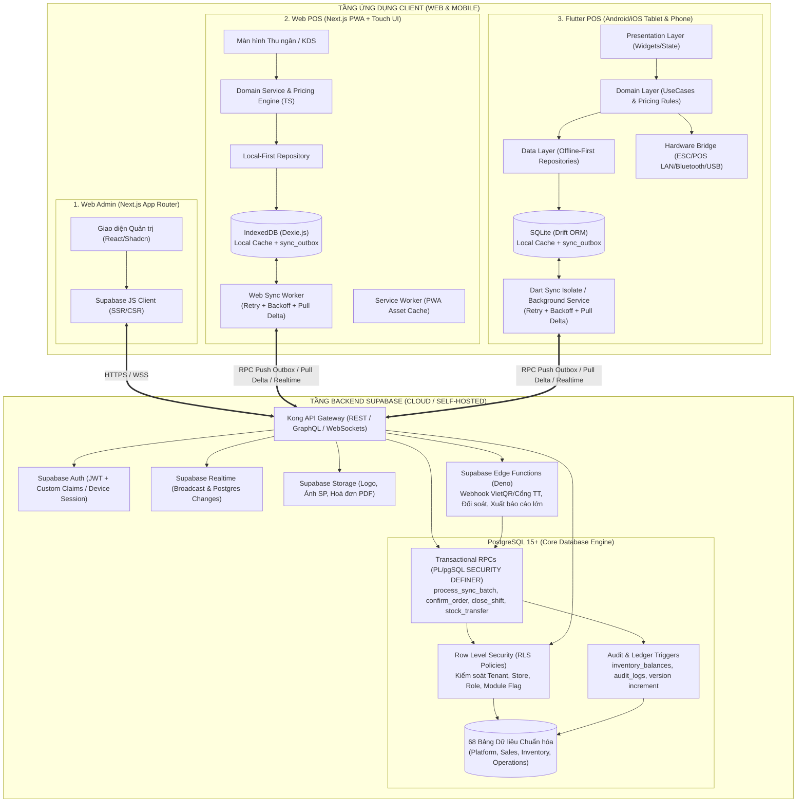
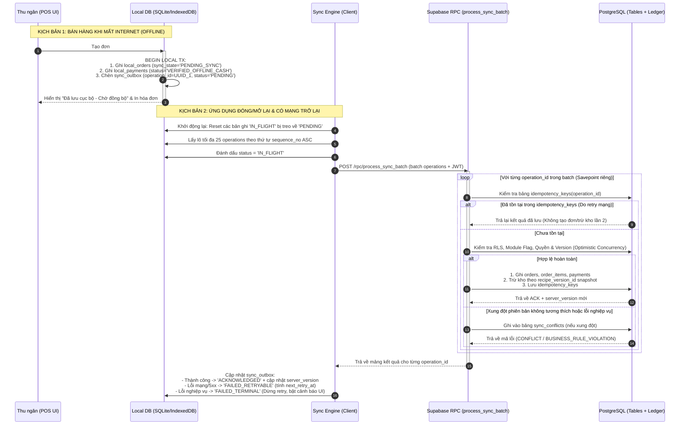

# ĐẶC TẢ KIẾN TRÚC & KỸ THUẬT HỆ THỐNG MODULAR POS (GIAI ĐOẠN 1)
**Phiên bản:** 2.0.0-phase1  
**Ngôn ngữ mặc định:** Tiếng Việt (`vi-VN`) | **Tiền tệ mặc định:** `VND` | **Múi giờ mặc định:** `Asia/Ho_Chi_Minh`  
**Nền tảng công nghệ:** Next.js (TypeScript Strict) + Flutter (Dart/Drift) + Supabase (PostgreSQL, Auth, RLS, Realtime, Edge Functions, Storage)

## 1. SƠ ĐỒ KIẾN TRÚC TỔNG THỂ HỆ THỐNG

### 1.1. Kiến trúc phân tầng (Layered & Offline-First Architecture)

Hệ thống Modular POS được thiết kế theo mô hình **Hybrid Cloud & Local-First POS**. Trong đó, **Web Admin** hoạt động theo mô hình Online-first (quản trị tập trung), còn **Web POS** và **Flutter POS** hoạt động theo mô hình **Offline-first** với cơ sở dữ liệu cục bộ (IndexedDB / SQLite) đóng vai trò là nguồn dữ liệu đọc/ghi tức thời cho giao diện thu ngân, đồng bộ hai chiều với Supabase thông qua **Sync Engine** và **Transactional Outbox**.



### 1.2. Vai trò và ranh giới trách nhiệm của 5 thành phần cốt lõi

| Thành phần | Công nghệ sử dụng | Trách nhiệm cốt lõi | Quy tắc giới hạn bảo mật & vận hành |
| :--- | :--- | :--- | :--- |
| **1. Web Admin** | Next.js 14+ (App Router), TypeScript Strict, TailwindCSS + Design System, TanStack Query | Quản lý cấu hình Organization/Store, Danh mục, Sản phẩm, Công thức (BOM), Kho, Mua hàng, Nhân sự, Phân quyền, Bật/tắt Module, Chẩn đoán lỗi đồng bộ và Báo cáo. | Không xử lý bán hàng offline; mọi thao tác cấu hình nhạy cảm đi qua RPC có ghi `audit_logs`. |
| **2. Web POS** | Next.js PWA, TypeScript Strict, IndexedDB (Dexie.js), Web Workers | Giao diện bán hàng tối ưu màn hình cảm ứng (Tại chỗ, Mang về, Giao hàng), Ca thu ngân, KDS trên trình duyệt, In qua WebPrint/Local Print Agent. | Không gọi trực tiếp bảng hệ thống để sửa tồn kho hay tổng tiền; đọc từ IndexedDB và ghi qua `sync_outbox`. |
| **3. Flutter POS** | Flutter Stable, Dart, Drift (SQLite), Riverpod/Bloc, Isolate Sync | Ứng dụng bán hàng chuyên dụng trên Tablet/Mobile (ưu tiên Android, sẵn sàng iOS), kết nối trực tiếp máy in nhiệt ESC/POS (LAN/Bluetooth/USB), hoạt động bền bỉ khi chập chờn mạng. | Widget UI tuyệt đối không truy cập trực tiếp Drift DB hay Supabase SDK; bắt buộc đi qua Presentation -> Domain -> Repository. |
| **4. Supabase Backend** | PostgreSQL, Supabase Auth, RLS, Realtime, Storage, Edge Functions, CLI Migrations | Nguồn sự thật duy nhất (Single Source of Truth), thực thi phân quyền RLS, kiểm tra Module Registry, đảm bảo tính nguyên tử (ACID) khi chốt đơn, trừ kho định lượng, đóng ca và đối soát thanh toán. | Mọi lệnh ghi quan trọng phải kiểm tra `idempotency_keys`; không tin tưởng `organization_id`, `store_id` hay tổng tiền do client tự tính nếu sai lệch quy tắc. |
| **5. Local Data Layer** | IndexedDB (Web) & SQLite/Drift (Flutter) + Outbox State Machine | Lưu trữ bền vững danh mục sản phẩm, bảng giá, công thức, sơ đồ bàn, ca hiện tại, đơn đang mở và hàng đợi `sync_outbox` qua các lần đóng/mở ứng dụng hoặc sập nguồn thiết bị. | Chỉ cache dữ liệu thuộc `store_id` mà thiết bị và nhân viên được cấp quyền; tự động xoá dữ liệu nhạy cảm khi thu hồi thiết bị. |

## 2. SƠ ĐỒ QUAN HỆ THỰC THỂ (ERD) VÀ MÔ HÌNH DỮ LIỆU CHUẨN HÓA

### 2.1. Quy tắc thiết kế cơ sở dữ liệu nền tảng

1. **Kiểu dữ liệu tiền tệ và định lượng (Tuyệt đối không dùng Floating Point):**
   - Mọi trường số tiền (`amount`, `unit_price`, `subtotal`, `tax_amount`, `discount_amount`, `total_amount`, `expected_cash`, `actual_cash`) sử dụng `NUMERIC(18, 4)` (hỗ trợ cả `VND` không có phần thập phân lẻ và ngoại tệ có 2-4 chữ số thập phân khi mở rộng đa quốc gia, đồng thời phục vụ tính giá vốn bình quân gia quyền chính xác tới 4 chữ số thập phân).
   - Mọi trường số lượng nguyên liệu và quy đổi đơn vị (`quantity`, `conversion_factor`, `wastage_percent`) sử dụng `NUMERIC(18, 6)` để tránh sai số làm tròn khi quy đổi từ `kg` -> `gram` hoặc `lít` -> `ml`.
2. **Phạm vi dữ liệu (Multi-Tenant & Multi-Branch Isolation):**
   - Bảng cấp toàn hệ thống: `modules`, `permissions`.
   - Bảng cấp Tổ chức (Tenant): Có khóa ngoại `organization_id UUID NOT NULL REFERENCES organizations(id)`.
   - Bảng cấp Chi nhánh (Branch/Store): Có cả `organization_id UUID NOT NULL` và `store_id UUID NOT NULL REFERENCES stores(id)` kèm composite index `(organization_id, store_id)` để tối ưu hóa truy vấn RLS và phân vùng dữ liệu.
3. **Chuẩn cột kiểm toán và đồng bộ (Audit & Sync Columns):**
   - Mọi bảng dữ liệu danh mục và giao dịch đều có: `id UUID PRIMARY KEY DEFAULT gen_random_uuid()`, `version INTEGER NOT NULL DEFAULT 1`, `created_at TIMESTAMPTZ NOT NULL DEFAULT now()`, `updated_at TIMESTAMPTZ NOT NULL DEFAULT now()`, và `deleted_at TIMESTAMPTZ NULL` (Soft delete cho dữ liệu cấu hình; bảng sổ cái như `inventory_transactions`, `payment_transactions`, `cash_movements`, `audit_logs` là **Append-Only**, cấm `UPDATE`/`DELETE` vật lý).

### 2.2. Sơ đồ ERD tổng quan (68 bảng thuộc 4 phân hệ)

```mermaid
erDiagram
    ORGANIZATIONS ||--o{ STORES : "owns"
    ORGANIZATIONS ||--o{ ORGANIZATION_SETTINGS : "configures"
    STORES ||--o{ STORE_SETTINGS : "overrides"
    ORGANIZATIONS ||--o{ MEMBERSHIPS : "has_members"
    PROFILES ||--o{ MEMBERSHIPS : "joins"
    MEMBERSHIPS ||--o{ USER_ROLES : "assigned"
    ROLES ||--o{ ROLE_PERMISSIONS : "grants"
    PERMISSIONS ||--o{ ROLE_PERMISSIONS : "included_in"
    MODULES ||--o{ ORGANIZATION_MODULES : "enabled_for_org"
    MODULES ||--o{ STORE_MODULES : "enabled_for_store"
    STORES ||--o{ DEVICES : "registers"
    DEVICES ||--o{ DEVICE_SESSIONS : "opens"

    STORES ||--o{ SERVICE_AREAS : "contains"
    SERVICE_AREAS ||--o{ SERVICE_POSITIONS : "has_tables_slots"
    ORGANIZATIONS ||--o{ CATEGORIES : "defines"
    CATEGORIES ||--o{ PRODUCTS : "classifies"
    PRODUCTS ||--o{ PRODUCT_VARIANTS : "has_variants"
    PRODUCTS ||--o{ PRODUCT_OPTIONS : "has_option_groups"
    PRODUCT_OPTIONS ||--o{ PRODUCT_OPTION_VALUES : "has_toppings_choices"
    STORES ||--o{ STORE_PRODUCT_SETTINGS : "customizes_availability"
    ORGANIZATIONS ||--o{ PRICE_LISTS : "manages"
    PRICE_LISTS ||--o{ PRODUCT_PRICES : "prices"

    STORES ||--o{ ORDERS : "processes"
    SERVICE_POSITIONS ||--o{ ORDERS : "serves_at"
    CUSTOMERS ||--o{ ORDERS : "places"
    ORDERS ||--|{ ORDER_ITEMS : "contains_lines"
    ORDER_ITEMS ||--o{ ORDER_ITEM_OPTIONS : "applies_modifiers"
    ORDERS ||--o{ ORDER_DISCOUNTS : "applies_discounts"
    DISCOUNTS ||--o{ ORDER_DISCOUNTS : "references"
    ORDERS ||--|{ ORDER_STATUS_HISTORY : "tracks_lifecycle"
    ORDERS ||--o{ PAYMENTS : "settles_via"
    PAYMENTS ||--|{ PAYMENT_TRANSACTIONS : "records_attempts"
    PAYMENT_METHODS ||--o{ PAYMENTS : "uses_method"
    ORDERS ||--o{ RECEIPTS : "issues"

    STORES ||--|{ INVENTORY_LOCATIONS : "operates_warehouses"
    ORGANIZATIONS ||--o{ INVENTORY_UNITS : "defines_units"
    INVENTORY_UNITS ||--o{ UNIT_CONVERSIONS : "converts_between"
    ORGANIZATIONS ||--o{ INVENTORY_ITEMS : "catalogs_materials"
    INVENTORY_LOCATIONS ||--o{ INVENTORY_BALANCES : "holds_stock"
    INVENTORY_ITEMS ||--o{ INVENTORY_BALANCES : "quantifies"
    INVENTORY_LOCATIONS ||--o{ INVENTORY_TRANSACTIONS : "logs_ledger"
    PRODUCTS ||--o{ RECIPES : "links_to_bom"
    RECIPES ||--|{ RECIPE_VERSIONS : "versions"
    RECIPE_VERSIONS ||--|{ RECIPE_COMPONENTS : "consumes_materials"
    INVENTORY_ITEMS ||--o{ RECIPE_COMPONENTS : "used_in"
    SUPPLIERS ||--o{ PURCHASE_ORDERS : "receives_po"
    PURCHASE_ORDERS ||--|{ PURCHASE_ORDER_ITEMS : "orders_lines"
    PURCHASE_ORDERS ||--o{ GOODS_RECEIPTS : "fulfilled_by"
    GOODS_RECEIPTS ||--|{ GOODS_RECEIPT_ITEMS : "receives_lines"
    STORES ||--o{ STOCK_TRANSFERS : "transfers_between"
    STOCK_TRANSFERS ||--|{ STOCK_TRANSFER_ITEMS : "moves_items"
    INVENTORY_LOCATIONS ||--o{ STOCK_COUNTS : "audits_stock"
    STOCK_COUNTS ||--|{ STOCK_COUNT_ITEMS : "counts_lines"

    STORES ||--o{ CASH_SHIFTS : "opens_shifts"
    CASH_SHIFTS ||--o{ CASH_MOVEMENTS : "logs_in_out"
    STORES ||--o{ KITCHEN_STATIONS : "sets_up_kds"
    ORDERS ||--o{ KITCHEN_TICKETS : "dispatches_to_kds"
    KITCHEN_TICKETS ||--|{ KITCHEN_TICKET_ITEMS : "prepares_items"
    STORES ||--o{ PRINT_JOBS : "queues_printing"
    ORDERS ||--o{ DELIVERY_ASSIGNMENTS : "assigns_shipper"
    STORES ||--o{ SYNC_CONFLICTS : "flags_conflicts"
    ORGANIZATIONS ||--o{ IDEMPOTENCY_KEYS : "deduplicates_ops"
```



### 2.3. Đặc tả chi tiết 4 nhóm bảng, Khóa ngoại và Phạm vi Tenant/Store

#### Nhóm 10.1: Nhóm Nền tảng (Platform Group — 16 bảng)

| STT | Tên bảng | Phạm vi (Scope) | Khóa chính & Khóa ngoại chính | Ràng buộc Unique & Index trọng tâm | Mô tả và Quy tắc lưu trữ |
| :---: | :--- | :--- | :--- | :--- | :--- |
| 1 | `organizations` | Global Root | `id` (PK), `owner_user_id` -> `profiles(id)` | `UNIQUE(slug)`, `UNIQUE(tax_code)` | Thông tin pháp nhân/thương hiệu, gói SaaS, tiền tệ mặc định (`VND`), múi giờ (`Asia/Ho_Chi_Minh`). |
| 2 | `stores` | Organization | `id` (PK), `organization_id` -> `organizations(id)` | `UNIQUE(organization_id, code)` | Chi nhánh/cửa hàng vật lý, địa chỉ, SĐT, trạng thái hoạt động (`ACTIVE`, `INACTIVE`, `SUSPENDED`). |
| 3 | `organization_settings` | Organization | `id` (PK), `organization_id` -> `organizations(id)` | `UNIQUE(organization_id, setting_key)` | Cấu hình cấp tổ chức (`JSONB`): chính sách thuế, làm tròn tiền, mẫu hóa đơn chung, cấu hình rủi ro offline. |
| 4 | `store_settings` | Store | `id` (PK), `organization_id`, `store_id` -> `stores(id)` | `UNIQUE(store_id, setting_key)` | Ghi đè cấu hình cấp cửa hàng: tài khoản VietQR riêng, chính sách trừ kho (`ON_CONFIRM`, `ON_KITCHEN_DONE`, `ON_COMPLETE`), giới hạn offline. |
| 5 | `profiles` | Global User | `id` (PK -> `auth.users(id)`) | `UNIQUE(email)`, `INDEX(phone)` | Hồ sơ người dùng đồng bộ từ Supabase Auth (`full_name`, `avatar_url`, `phone`, `status`). |
| 6 | `memberships` | Organization | `id` (PK), `organization_id`, `user_id` -> `profiles(id)` | `UNIQUE(organization_id, user_id)` | Liên kết nhân sự vào tổ chức; `scope_type` (`ORG_WIDE` hoặc `STORE_SPECIFIC`), trạng thái (`INVITED`, `ACTIVE`, `SUSPENDED`). |
| 7 | `roles` | Organization | `id` (PK), `organization_id` -> `organizations(id)` | `UNIQUE(organization_id, code)` | Vai trò: `OWNER`, `ORG_ADMIN`, `STORE_MANAGER`, `CASHIER`, `WAITER`, `KITCHEN_STAFF`, `WAREHOUSE_KEEPER`, `ACCOUNTANT`. |
| 8 | `permissions` | System Static | `id` (PK), `module_key` -> `modules(module_key)` | `UNIQUE(permission_key)` | Danh mục quyền hạt mịn (ví dụ: `pos.order.create`, `pos.order.void`, `inventory.adjust.approve`). |
| 9 | `role_permissions` | Organization | `id` (PK), `role_id` -> `roles(id)`, `permission_id` -> `permissions(id)` | `UNIQUE(role_id, permission_id)` | Bảng ánh xạ quyền cho từng vai trò trong tổ chức. |
| 10 | `user_roles` | Org / Store | `id` (PK), `membership_id` -> `memberships(id)`, `role_id` -> `roles(id)`, `store_id` NULLABLE -> `stores(id)` | `UNIQUE NULLS NOT DISTINCT (membership_id, role_id, store_id)` | Gán vai trò cho nhân viên ở cấp toàn tổ chức (`store_id IS NULL`) hoặc chỉ định cụ thể từng chi nhánh (`store_id IS NOT NULL`). |
| 11 | `devices` | Store | `id` (PK), `organization_id`, `store_id` -> `stores(id)` | `UNIQUE(store_id, device_fingerprint)` | Quản lý thiết bị POS/KDS được phép truy cập (`device_name`, `platform` (`WEB`, `ANDROID`, `IOS`), `is_authorized`, `last_sync_at`). |
| 12 | `device_sessions` | Store | `id` (PK), `device_id` -> `devices(id)`, `user_id` -> `profiles(id)`, `store_id` | `INDEX(device_id, is_active)` | Phiên đăng nhập thiết bị, theo dõi token, IP, phiên bản ứng dụng và trạng thái kết nối. |
| 13 | `modules` | System Static | `module_key` (PK, VARCHAR) | `PRIMARY KEY(module_key)` | Danh mục 41 module toàn hệ thống: `dependencies JSONB`, `configuration_schema JSONB`, `is_core BOOLEAN`. |
| 14 | `organization_modules` | Organization | `id` (PK), `organization_id`, `module_key` -> `modules(module_key)` | `UNIQUE(organization_id, module_key)` | Trạng thái bật/tắt và cấu hình module ở cấp tổ chức (`status`: `ENABLED`, `DISABLED`, `DRAINING`). |
| 15 | `store_modules` | Store | `id` (PK), `organization_id`, `store_id` -> `stores(id)`, `module_key` -> `modules(module_key)` | `UNIQUE(store_id, module_key)` | Cho phép bật/tắt hoặc cấu hình module riêng cho từng chi nhánh (ví dụ: Chi nhánh A bật `floor_tables`, Kiosk B chỉ bật `takeaway`). |
| 16 | `audit_logs` | Org / Store | `id` (PK), `organization_id`, `store_id` NULLABLE, `actor_user_id`, `device_id` | `INDEX(organization_id, store_id, created_at DESC)` | Bảng bất biến ghi nhận mọi thay đổi cấu hình, bật/tắt module, hủy đơn, mở két, sửa giá, điều chỉnh tồn kho (`before_state`, `after_state`, `reason`). |

#### Nhóm 10.2: Nhóm Bán hàng (Sales & Catalog Group — 21 bảng)

| STT | Tên bảng | Phạm vi (Scope) | Khóa chính & Khóa ngoại chính | Ràng buộc Unique & Index trọng tâm | Mô tả và Quy tắc lưu trữ |
| :---: | :--- | :--- | :--- | :--- | :--- |
| 17 | `service_areas` | Store | `id` (PK), `organization_id`, `store_id` -> `stores(id)` | `UNIQUE(store_id, code)` | Khu vực phục vụ tại chi nhánh (Tầng 1, Tầng 2, Sân vườn, Khu Mang về, Khu Giao hàng). |
| 18 | `service_positions` | Store | `id` (PK), `organization_id`, `store_id`, `area_id` -> `service_areas(id)`, `active_order_id` NULLABLE | `UNIQUE(store_id, position_type, code)` | Lưu trữ **Bàn tại chỗ** (`DINE_IN`, mặc định 20), **Vị trí mang về** (`TAKEAWAY_SLOT`, mặc định 10), **Vị trí giao hàng** (`DELIVERY_SLOT`, mặc định 10). Có `capacity`, `display_order`, `layout_meta`, `status` (`AVAILABLE`, `OCCUPIED`, `RESERVED`, `LOCKED`, `HIDDEN`). |
| 19 | `categories` | Organization | `id` (PK), `organization_id`, `parent_id` NULLABLE -> `categories(id)` | `UNIQUE(organization_id, code)` | Danh mục sản phẩm phân cấp, hỗ trợ gán khu vực in mặc định (`default_kitchen_station_type`). |
| 20 | `products` | Organization | `id` (PK), `organization_id`, `category_id` -> `categories(id)`, `base_unit_id` -> `inventory_units(id)` | `UNIQUE(organization_id, sku)` | Sản phẩm đa ngành: `product_type` (`STANDARD`, `VARIANT_PARENT`, `COMBO`, `SERVICE`), cờ `track_inventory`, `has_recipe`, `tax_rate`, `attributes JSONB`. |
| 21 | `product_variants` | Organization | `id` (PK), `organization_id`, `product_id` -> `products(id)`, `unit_id` -> `inventory_units(id)` | `UNIQUE(organization_id, sku)`, `INDEX(barcode)` | Biến thể sản phẩm (Size S/M/L, Màu sắc, Quy cách đóng gói), lưu `barcode`, `base_price`, `cost_price`. |
| 22 | `product_options` | Organization | `id` (PK), `organization_id`, `product_id` NULLABLE -> `products(id)` | `UNIQUE(organization_id, code)` | Nhóm tùy chọn / Topping (Mức đường, Mức đá, Thêm Topping): `min_select`, `max_select`, `is_required`. |
| 23 | `product_option_values` | Organization | `id` (PK), `organization_id`, `option_id` -> `product_options(id)`, `linked_inventory_item_id` NULLABLE | `UNIQUE(option_id, code)` | Giá trị tùy chọn (70% đường, Trân châu trắng +5.000đ); liên kết với nguyên liệu kho nếu topping có trừ định lượng. |
| 24 | `store_product_settings` | Store | `id` (PK), `organization_id`, `store_id`, `product_id`, `variant_id` NULLABLE | `UNIQUE NULLS NOT DISTINCT (store_id, product_id, variant_id)` | Cho phép ẩn/hiện món theo chi nhánh (`is_available`), báo hết hàng tạm thời (`is_out_of_stock`), gán trạm bếp (`kitchen_station_id`). |
| 25 | `price_lists` | Org / Store | `id` (PK), `organization_id`, `store_id` NULLABLE -> `stores(id)` | `UNIQUE NULLS NOT DISTINCT (organization_id, store_id, code)` | Bảng giá theo chi nhánh, kênh bán (`DINE_IN`, `TAKEAWAY`, `DELIVERY`) hoặc khung giờ (`valid_from`, `valid_to`, `priority`). |
| 26 | `product_prices` | Org / Store | `id` (PK), `organization_id`, `price_list_id` -> `price_lists(id)`, `product_id`, `variant_id` NULLABLE | `UNIQUE NULLS NOT DISTINCT (price_list_id, product_id, variant_id)` | Giá bán cụ thể (`price NUMERIC(18,4)`) trong từng bảng giá. |
| 27 | `orders` | Store | `id` (PK, Client UUID), `organization_id`, `store_id`, `shift_id` -> `cash_shifts(id)`, `service_position_id` NULLABLE, `customer_id` NULLABLE | `UNIQUE(store_id, order_number)`, `INDEX(store_id, order_status, created_at)` | Đơn hàng: `channel` (`DINE_IN`, `TAKEAWAY`, `DELIVERY`), tách biệt 4 trạng thái (`order_status`, `payment_status`, `fulfillment_status`, `delivery_status`), snapshot tiền tệ, `revision INTEGER`, `created_offline BOOLEAN`, `device_id`. |
| 28 | `order_items` | Store | `id` (PK, Client UUID), `organization_id`, `store_id`, `order_id` -> `orders(id)`, `product_id`, `variant_id` NULLABLE, `recipe_version_id` NULLABLE | `INDEX(order_id)` | Dòng chi tiết đơn hàng: lưu **Snapshot** `product_name_snapshot`, `sku_snapshot`, `unit_price_snapshot`, `quantity`, `discount_amount`, `tax_amount`, `line_total`, `kitchen_status`, `notes`. |
| 29 | `order_item_options` | Store | `id` (PK), `organization_id`, `store_id`, `order_item_id` -> `order_items(id)`, `option_value_id` -> `product_option_values(id)` | `INDEX(order_item_id)` | Snapshot topping/tùy chọn đi kèm từng món (`option_name_snapshot`, `value_name_snapshot`, `extra_price_snapshot`, `quantity`). |
| 30 | `order_status_history` | Store | `id` (PK), `organization_id`, `store_id`, `order_id` -> `orders(id)`, `changed_by` -> `profiles(id)` | `INDEX(order_id, created_at)` | Lịch sử chuyển trạng thái đơn hàng (ai chuyển, trên thiết bị nào, lý do hủy/chuyển bàn/gộp bàn). |
| 31 | `payments` | Store | `id` (PK, Client UUID), `organization_id`, `store_id`, `order_id` -> `orders(id)`, `shift_id` -> `cash_shifts(id)`, `payment_method_id` -> `payment_methods(id)` | `INDEX(order_id)`, `INDEX(shift_id, status)` | Bản ghi thanh toán cho đơn (hỗ trợ nhiều phương thức/đơn): `amount`, `tendered_amount` (khách đưa), `change_amount` (tiền thừa), `status` (`PENDING`, `VERIFIED_OFFLINE_CASH`, `SUCCEEDED`, `FAILED`, `REFUNDED`). |
| 32 | `payment_transactions` | Store | `id` (PK), `organization_id`, `store_id`, `payment_id` -> `payments(id)` | `UNIQUE NULLS NOT DISTINCT (provider_code, provider_tx_id)` | Giao dịch chi tiết với cổng thanh toán/ngân hàng/hoàn tiền (`tx_type`: `CHARGE`, `REFUND`, `VOID`, `WEBHOOK_VERIFY`; `raw_payload JSONB`). |
| 33 | `payment_methods` | Org / Store | `id` (PK), `organization_id`, `store_id` NULLABLE | `UNIQUE NULLS NOT DISTINCT (organization_id, store_id, code)` | Cấu hình phương thức: `CASH`, `BANK_TRANSFER`, `VIETQR`, `CARD_POS`, `COD`, `E_WALLET`; cờ `allow_offline_confirmation` (chỉ `TRUE` cho `CASH` hoặc theo cấu hình rủi ro). |
| 34 | `receipts` | Store | `id` (PK), `organization_id`, `store_id`, `order_id` -> `orders(id)` | `UNIQUE(store_id, receipt_number)` | Hóa đơn phát hành bất biến, lưu `snapshot_payload JSONB` toàn bộ thông tin cửa hàng, dòng hàng, thuế, thanh toán tại thời điểm chốt để in lại đúng lịch sử. |
| 35 | `customers` | Organization | `id` (PK), `organization_id` | `UNIQUE(organization_id, phone)` | Hồ sơ khách hàng, địa chỉ giao hàng mặc định, hạng thành viên, tổng chi tiêu, điểm tích lũy. |
| 36 | `discounts` | Org / Store | `id` (PK), `organization_id`, `store_id` NULLABLE | `UNIQUE(organization_id, code)` | Chương trình khuyến mãi / mã giảm giá (`PERCENTAGE`, `FIXED_AMOUNT`, `ITEM_DISCOUNT`, điều kiện áp dụng). |
| 37 | `order_discounts` | Store | `id` (PK), `organization_id`, `store_id`, `order_id` -> `orders(id)`, `discount_id` NULLABLE -> `discounts(id)` | `INDEX(order_id)` | Snapshot giảm giá áp dụng vào đơn hàng hoặc dòng món (`discount_name_snapshot`, `calculated_amount`, `authorized_by`). |

#### Nhóm 10.3: Nhóm Kho và Định lượng (Inventory & Recipe Group — 18 bảng)

| STT | Tên bảng | Phạm vi (Scope) | Khóa chính & Khóa ngoại chính | Ràng buộc Unique & Index trọng tâm | Mô tả và Quy tắc lưu trữ |
| :---: | :--- | :--- | :--- | :--- | :--- |
| 38 | `inventory_locations` | Store | `id` (PK), `organization_id`, `store_id` -> `stores(id)` | `UNIQUE(store_id, code)` | Kho vật lý trong một chi nhánh (ví dụ: Kho Chính, Kho Quầy Pha Chế, Kho Bếp Nóng). Một chi nhánh có thể có nhiều kho. |
| 39 | `inventory_units` | Organization | `id` (PK), `organization_id` | `UNIQUE(organization_id, code)` | Đơn vị tính (`g`, `kg`, `ml`, `l`, `cai`, `thung`, `hop`, `lon`). |
| 40 | `unit_conversions` | Organization | `id` (PK), `organization_id`, `inventory_item_id` NULLABLE -> `inventory_items(id)`, `from_unit_id` -> `inventory_units(id)`, `to_unit_id` -> `inventory_units(id)` | `UNIQUE NULLS NOT DISTINCT (organization_id, inventory_item_id, from_unit_id, to_unit_id)` | Bảng quy đổi đơn vị chung hoặc gắn riêng cho từng mặt hàng kho (ví dụ: 1 Thùng Sữa = 12 Hộp = 12.000 ml). |
| 41 | `inventory_items` | Organization | `id` (PK), `organization_id`, `base_unit_id` -> `inventory_units(id)`, `purchase_unit_id` -> `inventory_units(id)`, `issue_unit_id` -> `inventory_units(id)` | `UNIQUE(organization_id, sku)` | Danh mục vật tư kho: `item_type` (`RAW_MATERIAL`, `SEMI_FINISHED`, `FINISHED_GOOD`, `PACKAGING`, `DIRECT_RETAIL`), `cost_method` (`MOVING_AVERAGE`, `STANDARD`), `min_stock_level`. |
| 42 | `inventory_balances` | Store | `id` (PK), `organization_id`, `store_id`, `location_id` -> `inventory_locations(id)`, `inventory_item_id` -> `inventory_items(id)` | `UNIQUE(location_id, inventory_item_id)` | Bảng tổng hợp tồn kho tức thời (`on_hand_qty`, `reserved_qty`, `in_transit_qty`, `unit_cost`, `total_value`, `version`). Chỉ được cập nhật thông qua Trigger/RPC khi ghi `inventory_transactions`. |
| 43 | `inventory_transactions` | Store | `id` (PK, Client/Server UUID), `organization_id`, `store_id`, `location_id` -> `inventory_locations(id)`, `inventory_item_id` -> `inventory_items(id)`, `reference_order_id` NULLABLE, `reversal_of_tx_id` NULLABLE | `UNIQUE(idempotency_key)`, `INDEX(store_id, inventory_item_id, created_at)` | **Sổ cái giao dịch kho bất biến (Immutable Ledger)**. `tx_type`: `PURCHASE_RECEIPT`, `SALE_DEDUCTION`, `RECIPE_CONSUMPTION`, `INTERNAL_ISSUE`, `STOCK_COUNT_ADJUST`, `MANUAL_ADJUST`, `WASTAGE`, `TRANSFER_OUT`, `TRANSFER_IN`, `RETURN_REVERSAL`. Lưu `qty_change`, `balance_after`, `unit_cost`, `recipe_version_id`. |
| 44 | `recipes` | Org / Store | `id` (PK), `organization_id`, `store_id` NULLABLE -> `stores(id)`, `product_id` -> `products(id)`, `variant_id` NULLABLE, `option_value_id` NULLABLE | `UNIQUE NULLS NOT DISTINCT (organization_id, store_id, product_id, variant_id, option_value_id)` | Định nghĩa công thức định lượng (BOM) cho sản phẩm, biến thể hoặc topping; cho phép ghi đè công thức theo từng chi nhánh nếu cần. |
| 45 | `recipe_versions` | Org / Store | `id` (PK), `organization_id`, `recipe_id` -> `recipes(id)` | `UNIQUE(recipe_id, version_number)` | Phiên bản công thức (`version_number`, `status`: `DRAFT`, `ACTIVE`, `ARCHIVED`, `effective_from`, `effective_to`, `yield_qty`). Đơn hàng lưu `recipe_version_id` để bảo toàn lịch sử định lượng. |
| 46 | `recipe_components` | Org / Store | `id` (PK), `organization_id`, `recipe_version_id` -> `recipe_versions(id)`, `inventory_item_id` -> `inventory_items(id)`, `unit_id` -> `inventory_units(id)` | `UNIQUE(recipe_version_id, inventory_item_id)` | Thành phần định lượng trong một phiên bản công thức: `gross_qty`, `wastage_percent`, `net_qty`, `is_optional`. |
| 47 | `suppliers` | Organization | `id` (PK), `organization_id` | `UNIQUE(organization_id, code)` | Nhà cung cấp nguyên vật liệu/hàng hóa, điều khoản công nợ, thông tin liên hệ. |
| 48 | `purchase_orders` | Store | `id` (PK), `organization_id`, `store_id`, `supplier_id` -> `suppliers(id)`, `target_location_id` -> `inventory_locations(id)` | `UNIQUE(store_id, po_number)` | Đơn đặt hàng nhà cung cấp (`status`: `DRAFT`, `APPROVED`, `PARTIALLY_RECEIVED`, `COMPLETED`, `CANCELLED`). |
| 49 | `purchase_order_items` | Store | `id` (PK), `organization_id`, `store_id`, `purchase_order_id` -> `purchase_orders(id)`, `inventory_item_id` -> `inventory_items(id)` | `INDEX(purchase_order_id)` | Chi tiết mặt hàng đặt mua (`ordered_qty`, `received_qty`, `purchase_unit_id`, `unit_price`, `tax_rate`). |
| 50 | `goods_receipts` | Store | `id` (PK), `organization_id`, `store_id`, `purchase_order_id` NULLABLE -> `purchase_orders(id)`, `supplier_id` -> `suppliers(id)`, `location_id` -> `inventory_locations(id)` | `UNIQUE(store_id, grn_number)` | Phiếu nhập kho thực tế từ nhà cung cấp, sinh giao dịch `PURCHASE_RECEIPT` và cập nhật giá vốn. |
| 51 | `goods_receipt_items` | Store | `id` (PK), `organization_id`, `store_id`, `goods_receipt_id` -> `goods_receipts(id)`, `inventory_item_id` -> `inventory_items(id)` | `INDEX(goods_receipt_id)` | Chi tiết số lượng thực nhận, đơn giá nhập thực tế, lô/hạn sử dụng (`batch_code`, `expiry_date`). |
| 52 | `stock_transfers` | Org / Multi-Store | `id` (PK), `organization_id`, `from_store_id` -> `stores(id)`, `from_location_id` -> `inventory_locations(id)`, `to_store_id` -> `stores(id)`, `to_location_id` -> `inventory_locations(id)` | `UNIQUE(organization_id, transfer_number)` | Chứng từ điều chuyển kho (nội bộ chi nhánh hoặc liên chi nhánh): `status` (`REQUESTED`, `APPROVED`, `IN_TRANSIT`, `RECEIVED`, `DISCREPANCY`, `CANCELLED`). Hàng `IN_TRANSIT` chưa được cộng vào `on_hand_qty` kho nhận. |
| 53 | `stock_transfer_items` | Org / Multi-Store | `id` (PK), `organization_id`, `stock_transfer_id` -> `stock_transfers(id)`, `inventory_item_id` -> `inventory_items(id)` | `UNIQUE(stock_transfer_id, inventory_item_id)` | Số lượng yêu cầu (`requested_qty`), số lượng xuất (`shipped_qty`), số lượng thực nhận (`received_qty`), lý do chênh lệch. |
| 54 | `stock_counts` | Store | `id` (PK), `organization_id`, `store_id`, `location_id` -> `inventory_locations(id)` | `UNIQUE(store_id, count_number)` | Phiếu kiểm kê kho định kỳ hoặc đột xuất (`status`: `OPEN`, `REVIEWING`, `POSTED`, `CANCELLED`). |
| 55 | `stock_count_items` | Store | `id` (PK), `organization_id`, `store_id`, `stock_count_id` -> `stock_counts(id)`, `inventory_item_id` -> `inventory_items(id)` | `UNIQUE(stock_count_id, inventory_item_id)` | Ghi nhận `system_qty_snapshot`, `counted_qty`, `variance_qty`, `variance_value`; khi chốt phiếu sẽ sinh giao dịch `STOCK_COUNT_ADJUST`. |

#### Nhóm 10.4: Nhóm Vận hành (Operations, Shifts, KDS & Sync Group — 13 bảng)

| STT | Tên bảng | Phạm vi (Scope) | Khóa chính & Khóa ngoại chính | Ràng buộc Unique & Index trọng tâm | Mô tả và Quy tắc lưu trữ |
| :---: | :--- | :--- | :--- | :--- | :--- |
| 56 | `cash_shifts` | Store | `id` (PK, Client UUID), `organization_id`, `store_id`, `device_id` -> `devices(id)`, `opened_by` -> `profiles(id)`, `closed_by` NULLABLE | `UNIQUE INDEX(store_id, device_id) WHERE status = 'OPEN'` | Ca thu ngân: `opening_cash`, `expected_cash`, `actual_cash`, `discrepancy_amount`, `status` (`OPEN`, `CLOSING_REVIEW`, `CLOSED`, `RECONCILED`), `version`. Partial Unique Index ngăn mở 2 ca cùng lúc trên 1 thiết bị. |
| 57 | `cash_movements` | Store | `id` (PK, Client UUID), `organization_id`, `store_id`, `shift_id` -> `cash_shifts(id)` | `INDEX(shift_id, created_at)` | Phiếu thu/chi tiền mặt tại két (`movement_type`: `OPENING_FLOAT`, `SALE_CASH_IN`, `REFUND_CASH_OUT`, `PAY_IN`, `PAY_OUT`, `SAFE_DROP`). |
| 58 | `kitchen_stations` | Store | `id` (PK), `organization_id`, `store_id` -> `stores(id)` | `UNIQUE(store_id, code)` | Trạm chế biến KDS / Máy in khu vực (Bếp Nóng, Quầy Pha Chế, Quầy Bánh). |
| 59 | `kitchen_tickets` | Store | `id` (PK, Client UUID), `organization_id`, `store_id`, `order_id` -> `orders(id)`, `station_id` -> `kitchen_stations(id)` | `INDEX(store_id, station_id, status, priority DESC, created_at ASC)` | Phiếu chế biến gửi xuống KDS: `ticket_number`, `status` (`QUEUED`, `PREPARING`, `READY`, `SERVED`, `CANCELLED`), `priority`, `created_offline`. |
| 60 | `kitchen_ticket_items` | Store | `id` (PK), `organization_id`, `store_id`, `kitchen_ticket_id` -> `kitchen_tickets(id)`, `order_item_id` -> `order_items(id)` | `INDEX(kitchen_ticket_id)` | Từng món trong phiếu bếp (`quantity`, `status`, `started_at`, `completed_at`, `prepared_by`). |
| 61 | `print_jobs` | Store | `id` (PK, Client UUID), `organization_id`, `store_id`, `device_id`, `order_id` NULLABLE, `kitchen_ticket_id` NULLABLE | `UNIQUE(idempotency_key)`, `INDEX(store_id, status)` | Hàng đợi lệnh in (`job_type`: `RECEIPT`, `KITCHEN_TICKET`, `SHIFT_REPORT`; `status`: `QUEUED`, `PRINTED`, `FAILED`; `reprint_count`, `reprint_authorized_by`). |
| 62 | `delivery_assignments` | Store | `id` (PK), `organization_id`, `store_id`, `order_id` -> `orders(id)` | `UNIQUE(order_id)` | Điều phối giao hàng: `recipient_name`, `recipient_phone`, `delivery_address`, `shipping_fee`, `cod_amount`, `driver_name`, `driver_phone`, `status` (`UNASSIGNED`, `ASSIGNED`, `PICKED_UP`, `DELIVERED`, `FAILED_DELIVERY`, `RETURNED`, `RECONCILED`). |
| 63 | `expenses` | Store | `id` (PK), `organization_id`, `store_id`, `shift_id` NULLABLE -> `cash_shifts(id)` | `INDEX(store_id, expense_date)` | Chi phí vận hành tại cửa hàng (mua đá lẻ, phí vệ sinh, sửa chữa nhỏ), phân loại danh mục chi phí. |
| 64 | `reconciliation_records` | Store | `id` (PK), `organization_id`, `store_id`, `shift_id` NULLABLE | `INDEX(store_id, reconciliation_date)` | Biên bản đối soát thanh toán chuyển khoản, QR, ví điện tử và COD shipper cuối ca/cuối ngày. |
| 65 | `sync_conflicts` | Store | `id` (PK), `organization_id`, `store_id`, `device_id`, `operation_id` | `INDEX(store_id, resolution_status, created_at DESC)` | Lưu trữ các xung đột đồng bộ không thể tự động hợp nhất (`entity_type`, `entity_id`, `client_payload`, `server_state_snapshot`, `conflict_reason`, `resolution_status`: `PENDING`, `RESOLVED_KEEP_SERVER`, `RESOLVED_APPLY_CLIENT`, `RESOLVED_MERGED`). |
| 66 | `idempotency_keys` | Org / Store | `operation_id` (PK, UUID), `organization_id`, `store_id`, `device_id` | `PRIMARY KEY(operation_id)`, `INDEX(created_at)` | Bảng chống thực thi trùng cho mọi thao tác từ `sync_outbox` (`operation_type`, `request_hash`, `response_status`, `response_payload JSONB`, `processed_at`). |
| 67 | `integration_configs` | Org / Store | `id` (PK), `organization_id`, `store_id` NULLABLE | `UNIQUE NULLS NOT DISTINCT (organization_id, store_id, provider_code)` | Cấu hình tích hợp bên thứ ba (VietQR, cổng thanh toán, hóa đơn điện tử, đối tác vận chuyển); thông tin nhạy cảm lưu qua Supabase Vault. |
| 68 | `notification_events` | Store | `id` (PK), `organization_id`, `store_id`, `target_user_id` NULLABLE, `target_role_code` NULLABLE | `INDEX(store_id, is_read, created_at DESC)` | Sự kiện thông báo nội bộ (món KDS đã xong, cảnh báo tồn kho dưới định mức, cảnh báo lỗi đồng bộ thiết bị). |

## 3. SƠ ĐỒ MODULE REGISTRY, PHỤ THUỘC VÀ QUY TẮC BẬT/TẮT

### 3.1. Sơ đồ phụ thuộc Module (Module Dependency DAG)

Hệ thống quản lý tập trung **41 modules** chia làm 3 phân lớp: **10 Module Cốt lõi (Core)** (luôn bật, không thể vô hiệu hóa), **25 Module Nghiệp vụ (Business)** (bật/tắt linh hoạt theo Organization hoặc Store), và **6 Module SaaS (Platform)** (kích hoạt khi vận hành đa chủ sở hữu).

```mermaid
flowchart TD
    subgraph CoreLayer["NHÓM 1: MODULE CỐT LÕI (BẮT BUỘC - KHÔNG THỂ TẮT)"]
        core["1. core"]
        auth["2. authentication"] --> core
        orgs["3. organizations"] --> auth
        stores["4. stores"] --> orgs
        members["5. memberships"] --> stores
        rbac["6. authorization"] --> members
        mod_reg["7. module_registry"] --> rbac
        audit["8. audit_logs"] --> rbac
        dev_mgmt["10. device_management"] --> stores
        sync["9. sync_engine"] --> dev_mgmt
        sync --> mod_reg
    end

    subgraph CatalogAndPOS["NHÓM 2A: BÁN HÀNG, KÊNH PHỤC VỤ & VẬN HÀNH QUẦY"]
        catalog["1. products_catalog"] --> mod_reg
        pricing["2. pricing"] --> catalog
        orders["7. orders"] --> pricing
        orders --> sync
        payments["8. payments"] --> orders
        receipts["9. receipts"] --> payments
        pos["3. pos"] --> orders
        pos --> payments
        pos --> receipts
        shifts["11. shifts_cash"] --> pos
        printing["10. printing"] --> receipts
        floor["4. floor_tables"] --> pos
        takeaway["5. takeaway"] --> pos
        delivery["6. delivery"] --> pos
        kds["12. kitchen_display"] --> orders
    end

    subgraph InventoryAndSupply["NHÓM 2B: KHO, ĐỊNH LƯỢNG & CHUỖI CUNG ỨNG"]
        inv["13. inventory"] --> catalog
        recipes["14. recipes"] --> inv
        suppliers["16. suppliers"] --> inv
        purchasing["15. purchasing"] --> suppliers
    end

    subgraph CRMAndFinance["NHÓM 2C: KHÁCH HÀNG, ĐỐI SOÁT & BÁO CÁO"]
        customers["17. customers"] --> orders
        loyalty["18. loyalty"] --> customers
        promos["19. promotions"] --> pricing
        promos --> orders
        expenses["20. expenses"] --> shifts
        recon["21. reconciliation"] --> payments
        recon --> shifts
        reports["22. reports"] --> orders
        reports --> inv
        notif["23. notifications"] --> mod_reg
        integrations["24. integrations"] --> payments
        imp_exp["25. import_export"] --> catalog
    end

    subgraph SaaSLayer["NHÓM 3: MODULE SAAS TƯƠNG LAI"]
        entitle["3. entitlements"] --> mod_reg
        subs["1. subscriptions"] --> entitle
        billing["2. billing"] --> subs
        limits["4. usage_limits"] --> entitle
        onboard["5. tenant_onboarding"] --> orgs
        p_admin["6. platform_admin"] --> subs
    end
```



### 3.2. Bảng đặc tả Registry và Ma trận phụ thuộc của 41 Module

| Nhóm | Mã Module (`module_key`) | Tên hiển thị | Phụ thuộc trực tiếp (`dependencies`) | Phạm vi cấu hình | Cho phép tắt? | Quy tắc xử lý dữ liệu & tác vụ đang mở khi tắt (Draining Policy) |
| :--- | :--- | :--- | :--- | :--- | :---: | :--- |
| **Core** | `core`, `authentication`, `organizations`, `stores`, `memberships`, `authorization`, `module_registry`, `audit_logs`, `sync_engine`, `device_management` | 10 Module Cốt lõi | Phụ thuộc tuần tự nội bộ nhóm Core | System | **Không** | Database Trigger chặn mọi lệnh `UPDATE` đặt `status = 'DISABLED'` đối với các module có `is_core = TRUE`. |
| **Business** | `products_catalog` | Danh mục & Sản phẩm | `module_registry` | Org / Store | Có (nếu tắt POS) | Không thể tắt khi `pos`, `pricing`, hoặc `inventory` đang bật. |
| **Business** | `pricing` | Bảng giá & Quy tắc giá | `products_catalog` | Org / Store | Không (khi bật POS) | Không thể tắt khi `orders` hoặc `promotions` đang bật. |
| **Business** | `orders` | Quản lý Đơn hàng | `pricing`, `sync_engine` | Org / Store | Không (khi bật POS) | Chặn tắt nếu còn đơn hàng ở trạng thái `DRAFT`, `CONFIRMED`, `PREPARING` hoặc còn `sync_outbox` chưa xử lý. |
| **Business** | `payments` | Thanh toán | `orders` | Org / Store | Không (khi bật POS) | Chặn tắt nếu còn giao dịch `PENDING` hoặc ca thu ngân chưa chốt. |
| **Business** | `receipts` | Hóa đơn | `payments` | Org / Store | Không (khi bật POS) | Hóa đơn cũ vẫn tra cứu được ở chế độ Read-Only. |
| **Business** | `pos` | Màn hình Bán hàng POS | `orders`, `payments`, `receipts` | Store | Có | Phải đóng toàn bộ `cash_shifts` đang mở và hoàn tất/hủy mọi đơn đang mở tại chi nhánh trước khi tắt. |
| **Business** | `floor_tables` | Quản lý Bàn (Bán tại chỗ) | `pos` | Store | Có | Chặn tắt nếu bất kỳ bàn nào trong `service_positions` (`DINE_IN`) đang có `active_order_id IS NOT NULL`. Khi tắt, ẩn tab "Tại chỗ" trên POS nhưng giữ nguyên cấu hình 20 bàn trong DB. |
| **Business** | `takeaway` | Bán Mang về | `pos` | Store | Có | Chặn tắt nếu còn đơn `TAKEAWAY` chưa hoàn tất bàn giao. Phải giữ ít nhất 1 trong 3 kênh (`floor_tables`, `takeaway`, `delivery`) bật khi `pos` bật. |
| **Business** | `delivery` | Giao hàng & Shipper | `pos` | Store | Có | Chặn tắt nếu còn đơn `DELIVERY` ở trạng thái `ASSIGNED`/`PICKED_UP` hoặc chưa đối soát tiền COD (`reconciled = FALSE`). |
| **Business** | `printing` | Quản lý In ấn | `receipts` | Store | Có | Khi tắt, hệ thống vẫn tạo bản ghi `receipts` trong DB nhưng không đẩy lệnh vào `print_jobs`. |
| **Business** | `shifts_cash` | Ca thu ngân & Két tiền | `pos` | Store | Có | Chặn tắt nếu còn ca ở trạng thái `OPEN` hoặc `CLOSING_REVIEW`. |
| **Business** | `kitchen_display` | Màn hình Chế biến (KDS) | `orders` | Store | Có | Khi chuyển sang `DRAINING`, các `kitchen_tickets` đang mở vẫn cho phép bếp bấm hoàn tất, nhưng đơn mới tự động chuyển thẳng sang `READY` mà không tạo ticket mới. |
| **Business** | `inventory` | Quản lý Kho | `products_catalog` | Org / Store | Có | Chặn tắt nếu `recipes` hoặc `purchasing` đang bật, hoặc còn phiếu chuyển kho `IN_TRANSIT` / phiếu kiểm kê `OPEN`. Khi tắt, đơn bán hàng không sinh giao dịch trừ kho nhưng sổ cái cũ được giữ nguyên. |
| **Business** | `recipes` | Công thức & Định lượng | `inventory` | Org / Store | Có | Khi tắt, sản phẩm có công thức vẫn bán được nhưng hệ thống ghi nhận `recipe_version_id = NULL` và dừng trừ nguyên liệu định lượng. |
| **Business** | `purchasing` | Mua hàng & Nhập kho | `suppliers`, `inventory` | Org / Store | Có | Chặn tắt nếu còn `purchase_orders` đang ở trạng thái chờ nhận hàng dở dang (`PARTIALLY_RECEIVED`). |
| **Business** | `suppliers` | Nhà cung cấp | `inventory` | Org | Có | Không thể tắt khi `purchasing` đang bật. |
| **Business** | `customers` | Quản lý Khách hàng | `orders` | Org | Có | Không thể tắt khi `loyalty` đang bật; khi tắt, POS vẫn cho nhập tên/SĐT khách vãng lai vào đơn mang về/giao hàng. |
| **Business** | `loyalty` | Tích điểm & Thành viên | `customers` | Org / Store | Có | Khi tắt, số điểm hiện có của khách được đóng băng (không mất dữ liệu), POS ngừng cộng/trừ điểm cho đơn mới. |
| **Business** | `promotions` | Khuyến mãi & Giảm giá | `pricing`, `orders` | Org / Store | Có | Đơn đã áp dụng giảm giá giữ nguyên snapshot; đơn mới không thể áp mã mới. |
| **Business** | `expenses`, `reconciliation`, `reports`, `notifications`, `integrations`, `import_export` | Các module vận hành & phụ trợ | Theo sơ đồ DAG | Org / Store | Có | Kiểm tra không còn tác vụ đồng bộ hoặc webhook treo trước khi chuyển sang `DISABLED`. |
| **SaaS** | `subscriptions`, `billing`, `entitlements`, `usage_limits`, `tenant_onboarding`, `platform_admin` | 6 Module SaaS | Theo sơ đồ DAG | Platform | Có | Mặc định `DISABLED` ở giai đoạn Single-Owner Multi-Branch MVP, sẵn sàng bật ở Giai đoạn 9. |

### 3.3. Quy tắc kiểm tra phụ thuộc và thứ tự ưu tiên cấu hình (Inheritance Hierarchy)

1. **Thứ tự ưu tiên kế thừa cấu hình (Configuration Resolution Order):**
   Mọi cấu hình hệ thống được hợp nhất theo hàm `resolve_effective_config(org_id, store_id, device_id, module_key)` theo thứ tự ưu tiên từ cao xuống thấp:
   - **Mức 1 (Cao nhất — Thiết bị):** `devices.device_config` (chỉ áp dụng cho cấu hình phần cứng như máy in mặc định, chế độ hiển thị KDS/Thu ngân, bố cục lưới cảm ứng).
   - **Mức 2 (Chi nhánh):** `store_settings` / `store_modules.config` (ghi đè cấu hình cho chi nhánh cụ thể, ví dụ: tài khoản VietQR chi nhánh, chính sách trừ kho, hạn mức offline).
   - **Mức 3 (Tổ chức):** `organization_settings` / `organization_modules.config` (cấu hình chuẩn của toàn thương hiệu).
   - **Mức 4 (Thấp nhất — Mặc định hệ thống):** Giá trị `default` trong `modules.configuration_schema`.
   *Quy tắc bảo vệ:* Nếu một module bị đặt `status = 'DISABLED'` ở cấp `organization_modules`, thì không một `store_modules` nào thuộc tổ chức đó được phép bật (`ENABLED`) trừ khi tổ chức bật lại module đó.
2. **Kiểm tra bật/tắt tại Backend (Server-Side Enforcement):**
   - Hàm PostgreSQL `public.assert_module_enabled(p_org_id UUID, p_store_id UUID, p_module_key TEXT)` được gọi ngay đầu mọi RPC và trong điều kiện `WITH CHECK` của RLS Policy.
   - Mọi thao tác bật/tắt module phải đi qua RPC `public.set_module_status(...)`: hàm này kiểm tra đồ thị phụ thuộc ngược (không còn module con nào đang `ENABLED`), kiểm tra điều kiện Draining (không còn đơn mở / ca mở liên quan), cập nhật trạng thái và ghi bản ghi vào `audit_logs`.

## 4. THIẾT KẾ ROW LEVEL SECURITY (RLS) VÀ KIỂM SOÁT BẢO MẬT

### 4.1. Kiến trúc xác thực ngữ cảnh truy cập (ZeroClientTrust)

Hệ thống **tuyệt đối không tin tưởng** `organization_id` hoặc `store_id` do client truyền lên trong câu lệnh `SELECT`/`INSERT`/`UPDATE` thông thường. Mọi quyền truy cập được xác định từ `auth.uid()` kết hợp với các hàm bảo mật `SECURITY DEFINER` có `SET search_path = public, pg_temp`:

```sql
-- 1. Kiểm tra người dùng hiện tại có phải thành viên đang hoạt động của Organization không
CREATE OR REPLACE FUNCTION public.is_org_member(p_org_id UUID)
RETURNS BOOLEAN
LANGUAGE sql
STABLE
SECURITY DEFINER
SET search_path = public, pg_temp
AS $$
  SELECT EXISTS (
    SELECT 1
    FROM public.memberships m
    WHERE m.organization_id = p_org_id
      AND m.user_id = auth.uid()
      AND m.status = 'ACTIVE'
  );
$$;

-- 2. Kiểm tra người dùng có quyền truy cập vào Store cụ thể không
CREATE OR REPLACE FUNCTION public.has_store_access(p_org_id UUID, p_store_id UUID)
RETURNS BOOLEAN
LANGUAGE sql
STABLE
SECURITY DEFINER
SET search_path = public, pg_temp
AS $$
  SELECT EXISTS (
    SELECT 1
    FROM public.memberships m
    LEFT JOIN public.user_roles ur ON ur.membership_id = m.id
    WHERE m.organization_id = p_org_id
      AND m.user_id = auth.uid()
      AND m.status = 'ACTIVE'
      AND (
        m.scope_type = 'ORG_WIDE'
        OR ur.store_id IS NULL
        OR ur.store_id = p_store_id
      )
  );
$$;

-- 3. Kiểm tra người dùng có quyền cụ thể (permission_key) tại Store/Org VÀ Module đó đang bật
CREATE OR REPLACE FUNCTION public.authorize_action(
  p_org_id UUID,
  p_store_id UUID,
  p_permission_key VARCHAR,
  p_module_key VARCHAR
)
RETURNS BOOLEAN
LANGUAGE sql
STABLE
SECURITY DEFINER
SET search_path = public, pg_temp
AS $$
  SELECT EXISTS (
    SELECT 1
    FROM public.memberships m
    JOIN public.user_roles ur ON ur.membership_id = m.id
    JOIN public.role_permissions rp ON rp.role_id = ur.role_id
    JOIN public.permissions p ON p.id = rp.permission_id
    JOIN public.modules mod ON mod.module_key = p_module_key
    LEFT JOIN public.organization_modules om
      ON om.organization_id = p_org_id AND om.module_key = p_module_key
    LEFT JOIN public.store_modules sm
      ON sm.store_id = p_store_id AND sm.module_key = p_module_key
    WHERE m.organization_id = p_org_id
      AND m.user_id = auth.uid()
      AND m.status = 'ACTIVE'
      AND (m.scope_type = 'ORG_WIDE' OR ur.store_id IS NULL OR ur.store_id = p_store_id)
      AND p.permission_key = p_permission_key
      AND (
        mod.is_core = TRUE
        OR (
          COALESCE(om.status, 'ENABLED') = 'ENABLED'
          AND COALESCE(sm.status, om.status, 'ENABLED') IN ('ENABLED', 'DRAINING')
        )
      )
  );
$$;
```

### 4.2. Ma trận chính sách RLS và Kiểm soát Ghi qua RPC

Để ngăn chặn hoàn toàn việc Client tự ý sửa tổng tiền, tự xác nhận thanh toán chuyển khoản, tự sửa số dư tồn kho hoặc né kiểm tra nghiệp vụ, hệ thống phân tách rõ quyền `SELECT` qua RLS và quyền `INSERT/UPDATE/DELETE` qua **Transactional RPC (`SECURITY DEFINER`)**:

| Nhóm bảng | Chính sách `SELECT` (RLS) | Chính sách `INSERT / UPDATE / DELETE` trực tiếp từ PostgREST Client | Cổng thực thi nghiệp vụ bắt buộc (Server-side RPC / Edge Function) |
| :--- | :--- | :--- | :--- |
| `organizations`, `organization_settings` | `is_org_member(organization_id)` | Chỉ `OWNER` / `ORG_ADMIN` có quyền `org.settings.manage` | `rpc/update_organization_settings` (kèm ghi `audit_logs`) |
| `stores`, `store_settings`, `service_areas`, `service_positions` | `has_store_access(organization_id, store_id)` | Chỉ người có quyền `store.config.manage` tại `store_id` đó; cấm `DELETE` bàn khi `active_order_id IS NOT NULL` | `rpc/upsert_service_position`, `rpc/deactivate_service_position` |
| `products`, `product_variants`, `price_lists`, `product_prices` | `is_org_member(organization_id)` | Chỉ người có quyền `catalog.manage` hoặc `pricing.manage` | `rpc/publish_price_list` (tự động tăng `version` để POS đồng bộ) |
| `orders`, `order_items`, `order_item_options`, `order_discounts` | `has_store_access(organization_id, store_id)` | **Chặn ghi trực tiếp (`FALSE`)** đối với client role `authenticated` để ngăn sửa giá/tổng tiền trái phép | `rpc/process_sync_batch`, `rpc/pos_upsert_order`, `rpc/pos_transfer_merge_table`, `rpc/pos_split_order`, `rpc/pos_cancel_order` |
| `payments`, `payment_transactions`, `receipts` | `has_store_access(organization_id, store_id)` | **Chặn ghi trực tiếp (`FALSE`)** đối với client | `rpc/pos_record_cash_payment`, `rpc/pos_initiate_online_payment`, Edge Function `webhook-payment-verify`, `rpc/pos_refund_order` |
| `inventory_balances`, `inventory_transactions` | `has_store_access(organization_id, store_id)` | **Chặn tuyệt đối (`FALSE`)** mọi thao tác ghi trực tiếp từ client | Tự động sinh từ `rpc/pos_finalize_order_inventory`, `rpc/inv_post_goods_receipt`, `rpc/inv_execute_transfer`, `rpc/inv_post_stock_count` |
| `cash_shifts`, `cash_movements` | `has_store_access(organization_id, store_id)` | **Chặn ghi trực tiếp (`FALSE`)** | `rpc/shift_open`, `rpc/shift_record_cash_movement`, `rpc/shift_close` (có khóa `SELECT ... FOR UPDATE` chống đóng ca trùng) |
| `audit_logs`, `idempotency_keys` | Chỉ `ORG_ADMIN`, `STORE_MANAGER`, `ACCOUNTANT` có quyền `audit.view` trong phạm vi được cấp | **Chặn tuyệt đối (`FALSE`)** với mọi client (`INSERT` chỉ thực hiện bên trong trigger/RPC server) | Hệ thống tự động ghi nội bộ trong cùng Database Transaction |

## 5. ĐẶC TẢ LUỒNG ĐỒNG BỘ OFFLINE-FIRST VÀ GIẢI QUYẾT XUNG ĐỘT

### 5.1. Kiến trúc Local Database và Schema `sync_outbox`

Trên cả **Web POS** (IndexedDB qua Dexie.js) và **Flutter POS** (SQLite qua Drift), dữ liệu cục bộ được chia làm 3 vùng tách biệt:
1. **Read-Cache Tables (`local_catalog_*`, `local_config_*`):** Bản sao cục bộ của sản phẩm, danh mục, bảng giá, biến thể, topping, công thức định lượng (`recipe_versions`), sơ đồ bàn, phương thức thanh toán và cấu hình cửa hàng.
2. **Operational Working Tables (`local_orders`, `local_order_items`, `local_cash_shifts`, `local_print_jobs`):** Dữ liệu giao dịch phát sinh tại thiết bị, có cờ `sync_state` (`SYNCED`, `PENDING_SYNC`, `SYNC_ERROR`, `CONFLICT`).
3. **Durable Transactional Outbox (`sync_outbox`) & Watermark (`sync_metadata`):** Khi thu ngân bấm "Tạo đơn", "Thêm món", "Tạm tính" hoặc "Thu tiền mặt", ứng dụng thực hiện một **Local ACID Transaction** ghi đồng thời vào bảng Operational Working Table và chèn một bản ghi vào `sync_outbox`.

```sql
-- Schema chuẩn của bảng hàng đợi cục bộ sync_outbox (SQLite / Drift & IndexedDB tương đương)
CREATE TABLE sync_outbox (
    operation_id TEXT PRIMARY KEY,          -- UUID v4 tạo tại client trước khi thực thi
    sequence_no INTEGER AUTOINCREMENT,      -- Đảm bảo thứ tự FIFO nghiêm ngặt của các thao tác trên cùng thiết bị
    device_id TEXT NOT NULL,                -- UUID thiết bị đã đăng ký
    user_id TEXT NOT NULL,                  -- UUID nhân viên thực hiện thao tác
    organization_id TEXT NOT NULL,          -- UUID tổ chức
    store_id TEXT NOT NULL,                 -- UUID chi nhánh
    entity_type TEXT NOT NULL,              -- 'ORDER', 'PAYMENT_CASH', 'SHIFT', 'KITCHEN_STATUS', 'CASH_MOVEMENT'
    entity_id TEXT NOT NULL,                -- UUID của đơn hàng / ca / phiếu
    operation_type TEXT NOT NULL,           -- 'ORDER_CREATE', 'ORDER_UPDATE_ITEMS', 'ORDER_COMPLETE_CASH', 'SHIFT_OPEN', ...
    base_version INTEGER NOT NULL DEFAULT 0,-- Phiên bản của entity mà client nhìn thấy trước khi sửa
    payload_version INTEGER NOT NULL DEFAULT 1, -- Phiên bản schema của JSON payload
    payload TEXT NOT NULL,                  -- Chuỗi JSON chứa toàn bộ dữ liệu nghiệp vụ & snapshot giá/công thức
    created_at TEXT NOT NULL,               -- ISO-8601 timestamp lúc phát sinh thao tác tại client
    retry_count INTEGER NOT NULL DEFAULT 0, -- Số lần đã thử gửi lên server
    next_retry_at TEXT NULL,                -- Thời điểm được phép retry tiếp theo (Exponential Backoff)
    sync_status TEXT NOT NULL DEFAULT 'PENDING', -- 'PENDING', 'IN_FLIGHT', 'ACKNOWLEDGED', 'FAILED_RETRYABLE', 'FAILED_TERMINAL', 'CONFLICT'
    error_Category TEXT NULL,               -- 'TRANSIENT_NETWORK', 'AUTH_EXPIRED', 'BUSINESS_RULE_VIOLATION', 'VERSION_CONFLICT'
    last_error TEXT NULL,                   -- Mã lỗi và thông điệp chi tiết từ server
    server_acknowledged_at TEXT NULL        -- Timestamp khi server xác nhận đã xử lý thành công
);
```

### 5.2. Luồng đồng bộ hai chiều, Idempotency và Phục hồi sau khởi động lại



### 5.3. Chiến lược Retry, Phân loại lỗi và Giải quyết xung đột (Conflict Resolution Matrix)

1. **Chiến lược Retry & Backoff:**
   - Khi gặp lỗi mạng tạm thời (`TRANSIENT_NETWORK`, HTTP `408`, `429`, `502`, `503`, `504`), Sync Engine áp dụng công thức **Exponential Backoff with Full Jitter**:
     $$	ext{delay} = \min\left(300	ext{s}, 2^{	ext{retry\_count}} 	imes 1.5	ext{s}
ight) + 	ext{random}(0, 1000	ext{ms})$$
   - Khi gặp lỗi `AUTH_EXPIRED` (`401`): Tạm dừng hàng đợi, tự động gọi Refresh Token; nếu Refresh Token hết hạn hoặc nhân viên bị khóa tài khoản, giữ nguyên hàng đợi `sync_outbox` trên máy và hiển thị màn hình yêu cầu Quản lý cửa hàng hoặc nhân viên đăng nhập lại để tiếp tục đẩy dữ liệu (tuyệt đối không xóa `sync_outbox` khi hết hạn phiên).
   - Khi gặp lỗi `BUSINESS_RULE_VIOLATION` (`422`, ví dụ: ca thu ngân đã bị cưỡng chế đóng trên server, bàn bị khóa, mã giảm giá hết lượt): Đánh dấu `FAILED_TERMINAL`, **không retry vô hạn**, hiển thị huy hiệu đỏ trên thanh trạng thái ("Có lỗi đồng bộ") và mở giao diện **Sync Diagnostics Center** để Quản lý xử lý.

2. **Ma trận giải quyết xung đột theo từng loại dữ liệu:**

| Thực thể / Nghiệp vụ | Cơ chế phát hiện xung đột | Quy tắc tự động hợp nhất (Auto-Merge) | Khi nào đẩy vào `sync_conflicts` chờ người có quyền xử lý? |
| :--- | :--- | :--- | :--- |
| **Đơn hàng đang mở (`orders`) trên nhiều thiết bị** | So sánh `base_version` trong outbox với `orders.revision` trên server và định danh từng dòng `order_items.id` (Client UUID). | Nếu Thiết bị A thêm Món X (`item_id_1`) và Thiết bị B thêm Món Y (`item_id_2`) vào cùng một bàn đang mở: Server **tự động hợp nhất (Operational Merge)** cả 2 dòng món, tính lại tổng đơn và tăng `revision`. | Khi Thiết bị A sửa/xóa một dòng món mà Thiết bị B đã thanh toán hoặc đã hủy đơn đó trên server -> Giữ nguyên trạng thái server, ghi `sync_conflicts` để Quản lý duyệt. |
| **Sản phẩm, Giá bán & Công thức (`products`, `product_prices`, `recipe_versions`)** | Đơn hàng offline lưu cứng `unit_price_snapshot` và `recipe_version_id` tại thời điểm bán. | Server tôn trọng giá snapshot của đơn offline nếu nằm trong ngưỡng thời gian cho phép (`max_offline_order_age_hours`, mặc định 24h) và ghi chú vào audit log nếu giá catalog đã đổi. | Nếu giá offline chênh lệch vượt ngưỡng bảo vệ cấu hình hoặc sản phẩm bị thu hồi khẩn cấp -> Đánh dấu đơn cần Quản lý xác nhận lại giá. |
| **Tồn kho (`inventory_transactions`)** | Mọi giao dịch kho định danh bằng `idempotency_key = operation_id + line_id`. | Cộng/trừ lũy kế theo sổ cái bất biến (`SALE_DEDUCTION` / `RECIPE_CONSUMPTION`). Cho phép tồn kho trên sổ cái tạm thời âm (`allow_negative_stock_on_sync = TRUE`) khi nhiều máy offline cùng bán một mặt hàng. | Nếu mặt hàng cấu hình `strict_serial_or_lot = TRUE` hoặc tồn kho âm vượt ngưỡng cảnh báo -> Hoàn tất đồng bộ đơn hàng nhưng sinh cảnh báo kiểm kê tức thời tại `sync_conflicts`. |
| **Thanh toán (`payments`)** | Kiểm tra `idempotency_key` và tổng tiền đã thu so với `orders.total_amount`. | Tiền mặt offline (`VERIFIED_OFFLINE_CASH`) được ghi nhận kèm `device_id` và `shift_id`. Thanh toán online/QR không bao giờ được client tự đánh dấu `SUCCEEDED` khi offline. | Nếu một đơn hàng bị thu tiền mặt trên Thiết bị A lúc offline nhưng đồng thời khách đã quét QR thành công trên Server -> Ghi nhận cả 2 vào sổ đối soát và tạo `sync_conflicts` loại `OVERPAYMENT_DUPLICATE` để hoàn tiền thừa cho khách. |
| **Ca thu ngân (`cash_shifts`)** | Khoá phiên bản `version` và ràng buộc `UNIQUE(store_id, device_id) WHERE status = 'OPEN'`. | Các giao dịch thu/chi tiền mặt offline tự động gắn vào `shift_id` tương ứng; nếu ca đó đã bị đóng cưỡng chế bởi Admin, gắn vào bản ghi điều chỉnh sau chốt ca (`POST_CLOSE_ADJUSTMENT`). | Nếu 2 thiết bị cùng gửi lệnh đóng cùng 1 ca (`SHIFT_CLOSE`) với số tiền kiểm đếm thực tế khác nhau -> Chỉ lệnh đầu tiên thành công, lệnh thứ hai lưu vào `sync_conflicts`. |

### 5.4. Ma trận trạng thái kết nối trên UI và Giới hạn rủi ro Offline theo chi nhánh

- **4 Trạng thái hiển thị bắt buộc trên Header của Web POS & Flutter POS:**
  1. `ONLINE` (Xanh lá): Kết nối ổn định, `sync_outbox` trống (`0 đơn chờ`).
  2. `OFFLINE` (Vàng cam): Mất kết nối Internet, hiển thị bộ đếm thời gian offline và số lượng thao tác đang lưu cục bộ (`Đang Offline • 4 đơn chờ đồng bộ`).
  3. `SYNCING` (Xanh dương xoay): Đang đồng bộ hàng đợi (`Đang đồng bộ 2/4...`).
  4. `SYNC_ERROR` (Đỏ cảnh báo): Có ít nhất 1 thao tác ở trạng thái `FAILED_TERMINAL` hoặc `CONFLICT` cần kiểm tra tại màn hình Chẩn đoán đồng bộ.
- **Chính sách giới hạn rủi ro Offline cấu hình theo Chi nhánh (`store_settings.offline_policy`):**
  - `max_offline_duration_hours` (Mặc định: `24 giờ`): Quá thời gian này mà chưa đồng bộ với server, POS khóa chức năng tạo đơn mới (trừ khi Quản lý nhập mã PIN khẩn cấp tại chỗ).
  - `max_offline_unack_orders` (Mặc định: `200 đơn`): Giới hạn số đơn chưa đồng bộ tối đa trên một thiết bị.
  - `allow_offline_void_or_refund` (Mặc định: `FALSE`): Cấm hủy đơn đã thanh toán hoặc hoàn tiền khi thiết bị đang offline.
  - `offline_payment_methods_allowed`: Mặc định chỉ cho phép `["CASH", "COD"]`; các phương thức `VIETQR` / `BANK_TRANSFER` khi offline chỉ được lưu ở trạng thái `PENDING_VERIFICATION` (chưa xác nhận đã thu tiền).

## 6. ĐẶC TẢ NGHIỆP VỤ POS, CA THU NGÂN, THANH TOÁN VÀ KHO NGUYÊN LIỆU

### 6.1. Quản lý Bàn và 3 Kênh phục vụ (Tại chỗ, Mang về, Giao hàng)

Khi khởi tạo một chi nhánh mới (`stores`), hệ thống tự động seed vào bảng `service_positions`:
- **20 Bàn bán tại chỗ (`position_type = 'DINE_IN'`):** Mã `TB-01` đến `TB-20`, thuộc khu vực mặc định, có sức chứa (`capacity`), toạ độ hiển thị (`display_order`, `pos_x`, `pos_y`), trạng thái (`AVAILABLE`, `OCCUPIED`, `LOCKED`, `HIDDEN`).
- **10 Vị trí hiển thị đơn mang về (`position_type = 'TAKEAWAY_SLOT'`):** Mã `TW-01` đến `TW-10`. Đây là 10 ô truy cập nhanh trên màn hình cảm ứng; nếu quán có đơn mang về thứ 11 trở đi cùng lúc, các đơn vượt quá số ô vẫn được tạo không giới hạn và hiển thị trong danh sách hàng đợi mang về (`Takeaway Queue Drawer`).
- **10 Vị trí hiển thị đơn giao hàng (`position_type = 'DELIVERY_SLOT'`):** Mã `DL-01` đến `DL-10`. Tương tự, số đơn giao hàng thực tế không bị giới hạn bởi 10 ô hiển thị nhanh này.
- **Quy tắc nghiệp vụ bàn:**
  - **Chuyển bàn (`Transfer Table`):** Chuyển `service_position_id` của đơn đang mở từ Bàn A sang Bàn B (đang `AVAILABLE`); giải phóng Bàn A về `AVAILABLE`, đổi Bàn B sang `OCCUPIED`, ghi `order_status_history` và phát thông báo KDS/máy in bếp ("Bàn 01 chuyển sang Bàn 05").
  - **Gộp bàn (`Merge Tables`):** Chuyển toàn bộ `order_items` và `payments` tạm ứng của Đơn phụ (Bàn B) sang Đơn chính (Bàn A), tăng `revision` Đơn A, chuyển Đơn B sang trạng thái `MERGED_CLOSED` (lưu `merged_into_order_id = Order_A.id`), giải phóng Bàn B.
  - **Tách món / Tách hóa đơn (`Split Order`):** Tạo Đơn mới (Đơn C) từ một phần số lượng hoặc một số dòng món của Đơn A trong cùng 1 transaction; đảm bảo tổng số lượng món và tổng tiền trước/sau khi tách khớp tuyệt đối, không sinh thêm yêu cầu chế biến KDS cho các món đã gửi bếp.
  - **Bảo vệ xóa/ẩn bàn:** Database Trigger chặn mọi lệnh `DELETE` hoặc chuyển trạng thái `HIDDEN`/`LOCKED` đối với `service_positions` đang có `active_order_id IS NOT NULL`.

### 6.2. Máy trạng thái đa chiều của Đơn hàng (Multi-Dimensional Order State Machine)

Để phản ánh đúng thực tế vận hành F&B và Bán lẻ (ví dụ: khách ăn tại bàn đã lên đủ món nhưng chưa thanh toán, hoặc khách đặt mang về đã thanh toán trước nhưng bếp đang pha chế), bảng `orders` tách bạch 4 trục trạng thái độc lập:

1. **`order_status` (Trạng thái vòng đời đơn):**
   `DRAFT` (Đang chọn món/tạm lưu) $
ightarrow$ `CONFIRMED` (Đã xác nhận đơn) $
ightarrow$ `COMPLETED` (Hoàn tất toàn bộ nghĩa vụ thanh toán & giao nhận) | `CANCELLED` (Hủy trước khi hoàn tất) | `MERGED_CLOSED` (Đóng do gộp bàn).
2. **`payment_status` (Trạng thái tài chính):**
   `UNPAID` $
ightarrow$ `PARTIALLY_PAID` $
ightarrow$ `PENDING_VERIFICATION` (Khách báo đã chuyển khoản/quét QR lúc offline hoặc chờ webhook) $
ightarrow$ `PAID` $
ightarrow$ `PARTIALLY_REFUNDED` | `REFUNDED`.
3. **`fulfillment_status` (Trạng thái chế biến / xuất hàng):**
   `NOT_REQUIRED` (Hàng bán lẻ lấy trực tiếp) | `QUEUED` (Đã gửi KDS) $
ightarrow$ `PREPARING` (Bếp đang làm) $
ightarrow$ `READY` (Đã xong, chờ bưng/giao) $
ightarrow$ `SERVED` (Đã bàn giao cho khách/shipper).
4. **`delivery_status` (Trạng thái giao hàng — chỉ áp dụng khi `channel = 'DELIVERY'`):**
   `NONE` | `PENDING_ASSIGNMENT` $
ightarrow$ `ASSIGNED` $
ightarrow$ `OUT_FOR_DELIVERY` $
ightarrow$ `DELIVERED` $
ightarrow$ `COD_RECONCILED` | `DELIVERY_FAILED` $
ightarrow$ `RETURNED_TO_STORE`.

**Quy tắc giải phóng bàn tự động:** Một bàn tại chỗ (`DINE_IN`) chỉ tự động chuyển về `AVAILABLE` khi `order_status IN ('COMPLETED', 'CANCELLED', 'MERGED_CLOSED')` (cấu hình cửa hàng có thể chọn giải phóng bàn ngay khi `payment_status = 'PAID'` hoặc khi nhân viên bấm "Khách rời bàn" sau khi vừa `PAID` vừa `SERVED`).

### 6.3. Quy tắc tính tiền chuẩn xác và Quản lý Thanh toán

1. **Công thức tính tiền đơn hàng (Pricing & Tax Calculation Pipeline):**
   Tất cả phép tính thực hiện trên kiểu số nguyên/thập phân cố định (`Decimal` trên TypeScript/Dart và `NUMERIC(18,4)` trên PostgreSQL), làm tròn theo cấu hình tiền tệ (`VND`: làm tròn đến hàng đơn vị `ROUND_HALF_UP`):
   - **Đơn giá dòng món (`effective_unit_price`):**
     $$	ext{effective\_unit\_price} = 	ext{unit\_price\_snapshot} + \sum (	ext{option\_extra\_price\_snapshot} 	imes 	ext{option\_qty})$$
   - **Thành tiền dòng món trước giảm giá (`line_gross`):**
     $$	ext{line\_gross} = 	ext{effective\_unit\_price} 	imes 	ext{item\_quantity}$$
   - **Thành tiền dòng món sau giảm giá dòng (`line_net`):**
     $$	ext{line\_net} = \max(0, 	ext{line\_gross} - 	ext{line\_discount\_amount})$$
   - **Phân bổ giảm giá toàn đơn (`order_level_discount`):** Được phân bổ tỷ lệ thuận (pro-rata) xuống từng dòng món theo trọng số `line_net` (dòng cuối cùng nhận phần dư làm tròn để tổng phân bổ khớp 100% với `order_discount_amount`), giúp tính đúng thuế GTGT khi trong cùng một đơn có các mặt hàng chịu thuế suất khác nhau (ví dụ: 8% và 10%).
   - **Tổng thanh toán (`total_amount`):**
     $$	ext{total\_amount} = 	ext{subtotal} - 	ext{line\_discount\_total} - 	ext{order\_discount\_amount} + 	ext{service\_charge\_amount} + 	ext{tax\_amount} + 	ext{shipping\_fee} + 	ext{rounding\_adjustment}$$
2. **Định nghĩa chuẩn các chỉ số Báo cáo Tài chính (Không trộn lẫn đơn chưa thu tiền):**
   - **Doanh thu gộp (`Gross Sales`):** Tổng `line_gross` của các đơn có `order_status = 'COMPLETED'`.
   - **Giảm giá (`Total Discounts`):** Tổng giảm giá dòng + giảm giá đơn của các đơn `COMPLETED`.
   - **Hoàn tiền (`Refunds`):** Tổng giá trị các giao dịch hoàn trả được duyệt (`payment_transactions.tx_type = 'REFUND'`).
   - **Doanh thu thuần (`Net Revenue`):** $	ext{Gross Sales} - 	ext{Total Discounts} - 	ext{Refunds (trước thuế)}$.
   - **Tiền thực thu (`Actual Collected Cash/Funds`):** Tổng số tiền từ các bản ghi `payments` có trạng thái `SUCCEEDED` hoặc `VERIFIED_OFFLINE_CASH` trừ đi tiền hoàn trả thực tế. **Tuyệt đối không cộng các đơn `UNPAID` hoặc `PENDING_VERIFICATION` vào Tiền thực thu.**

### 6.4. Luồng Kho, Công thức Định lượng (Recipe Snapshot) và Sổ giao dịch Kho bất biến

1. **Quy đổi đơn vị 3 tầng:**
   Mỗi `inventory_items` định nghĩa:
   - `base_unit_id` (Đơn vị gốc lưu sổ cái tồn kho, ví dụ: `ml` hoặc `gram` hoặc `cái`).
   - `purchase_unit_id` (Đơn vị mua hàng, ví dụ: `Thùng` = 12 `Hộp` = 12.000 `ml`).
   - `issue_unit_id` (Đơn vị xuất/định lượng công thức, ví dụ: `ml`).
   Mọi giao dịch ghi vào `inventory_transactions` và `inventory_balances` đều được chuẩn hóa về `base_unit_id`, kèm lưu `display_qty` và `display_unit_id` của chứng từ gốc để dễ kiểm tra.
2. **Cơ chế Snapshot Phiên bản Công thức (`recipe_version_id`):**
   - Khi một sản phẩm có `has_recipe = TRUE` được thêm vào đơn hàng và xác nhận, hệ thống tra cứu phiên bản công thức đang có hiệu lực (`recipe_versions` có `status = 'ACTIVE'` cho `store_id` hoặc `organization_id` đó) và gắn cứng `recipe_version_id` vào dòng `order_items`.
   - Nếu 1 tuần sau Admin thay đổi định lượng trà từ `150ml` lên `180ml`, hệ thống tạo `recipe_versions` mới (`version_number = 2`). Các đơn hàng cũ hoặc đơn offline tạo trước thời điểm đó vẫn tham chiếu `version_number = 1`, bảo đảm truy vết lịch sử tiêu hao nguyên liệu và giá vốn (COGS) không bao giờ bị sai lệch hồi tố.
3. **Chính sách thời điểm trừ kho (`inventory_deduction_policy`) và Chống trừ kho trùng:**
   - Cửa hàng cấu hình 1 trong 3 chính sách nhất quán (lưu snapshot chính sách này trên `orders.deduction_policy_snapshot` ngay khi tạo đơn để không áp dụng mâu thuẫn trong cùng một đơn):
     - `ON_ORDER_CONFIRM`: Trừ kho ngay khi đơn chuyển sang `CONFIRMED` (phù hợp bán lẻ/tạp hóa).
     - `ON_KITCHEN_START_OR_READY`: Trừ nguyên liệu khi KDS chuyển món sang `PREPARING`/`READY` (phù hợp nhà hàng/cà phê có KDS).
     - `ON_ORDER_COMPLETE`: Trừ kho khi đơn hoàn tất thanh toán/giao hàng (phù hợp quầy bán nhanh không dùng KDS).
   - **Định danh chống trừ trùng (Idempotent Deduction Key):**
     Mỗi dòng giao dịch trừ kho bán hàng sinh khóa duy nhất:
     $$	ext{idempotency\_key} = 	ext{"SALE\_DEDUCT:"} \parallel 	ext{order\_item\_id} \parallel 	ext{":"} \parallel 	ext{inventory\_item\_id} \parallel 	ext{":"} \parallel 	ext{component\_source}$$
     Nhờ ràng buộc `UNIQUE(idempotency_key)` trên bảng `inventory_transactions`, dù thiết bị POS retry đồng bộ đơn hàng 10 lần hay gọi lại RPC, PostgreSQL chỉ ghi nhận giao dịch trừ kho **đúng 1 lần duy nhất**.
   - **Xử lý Hủy đơn / Hoàn trả (Bù trừ bất biến):**
     - Nếu đơn bị hủy **trước** thời điểm trừ kho: Không phát sinh giao dịch kho.
     - Nếu đơn bị hủy hoặc hoàn trả **sau** khi đã trừ kho: Hệ thống **tuyệt đối không xóa** dòng `SALE_DEDUCTION` cũ. Thay vào đó, RPC yêu cầu nhân viên chọn lý do xử lý hàng hoàn:
       - *Trường hợp 1 (Hàng chưa chế biến / Hàng bán lẻ còn nguyên vẹn):* Ghi giao dịch mới `tx_type = 'RETURN_REVERSAL'` với `qty_change > 0` và `reversal_of_tx_id` trỏ về giao dịch gốc để hoàn nhập lại tồn kho.
       - *Trường hợp 2 (Đồ uống/món ăn đã pha chế xong nhưng khách hủy):* Nguyên liệu đã tiêu hao thực tế nên giữ nguyên lượng trừ và ghi nhận bản ghi phân loại hao hụt hủy món (`WASTAGE_CANCELLED_ORDER`) để báo cáo thất thoát.

### 6.5. Ca thu ngân, KDS và In ấn

1. **Ca thu ngân (`cash_shifts`):**
   - Mở ca: Ghi nhận `opening_cash` (tiền lẻ đầu ca).
   - Trong ca: Mọi giao dịch thu tiền mặt (`SALE_CASH_IN`), hoàn tiền mặt (`REFUND_CASH_OUT`), nộp thêm tiền lẻ (`PAY_IN`), rút tiền chi phí/cất két (`PAY_OUT`/`SAFE_DROP`) đều ghi vào `cash_movements`.
   - Đóng ca (`rpc/shift_close`): Sử dụng `SELECT * FROM cash_shifts WHERE id = p_shift_id FOR UPDATE` để khóa dòng ca. Nếu `status != 'OPEN'`, từ chối ngay lập tức (ngăn chặn 2 thao tác đóng ca đồng thời). Tính toán:
     $$	ext{expected\_cash} = 	ext{opening\_cash} + \sum 	ext{SALE\_CASH\_IN} + \sum 	ext{PAY\_IN} - \sum 	ext{REFUND\_CASH\_OUT} - \sum 	ext{PAY\_OUT} - \sum 	ext{SAFE\_DROP}$$
     $$	ext{discrepancy\_amount} = 	ext{actual\_cash} - 	ext{expected\_cash}$$
     Nếu `ABS(discrepancy_amount)` vượt ngưỡng cho phép của cửa hàng, ca chuyển sang `CLOSING_REVIEW` và yêu cầu quyền `shifts.discrepancy.approve` của Quản lý.
2. **Màn hình chế biến KDS (`kitchen_display`) & In ấn (`printing`):**
   - Khi đơn xác nhận, các món được gom nhóm theo `kitchen_station_id` (Bếp Nóng, Quầy Bar) để sinh `kitchen_tickets`.
   - Các thiết bị trong cùng mạng nội bộ/cùng chi nhánh nhận cập nhật qua Supabase Realtime (khi Online). Nếu rớt mạng Internet, đơn tạo trên chính máy POS được hiển thị tại KDS tích hợp trên thiết bị và đẩy vào hàng đợi in nội bộ (LAN ESC/POS); khi có mạng lại, các ticket offline đồng bộ lên server với cờ `created_offline = TRUE` để không phát lệnh chế biến trùng lặp cho những món đã đánh dấu `SERVED` dưới máy trạm.
   - Bảng `print_jobs` tách biệt hoàn toàn với bảng `receipts`: Hóa đơn (`receipts`) được tạo ngay trong transaction chốt đơn; việc máy in kẹt giấy hoặc mất kết nối chỉ làm `print_jobs.status = 'FAILED'`, cho phép thu ngân bấm "In lại" (có kiểm tra quyền `printing.receipt.reprint` và đóng dấu `"BẢN IN LẠI LẦN n"` trên mẫu in).

## 7. CẤU TRÚC MONOREPO VÀ CHUẨN TỔ CHỨC MODULE

### 7.1. Cây thư mục chuẩn của Dự án (`modular-pos/`)

Dự án sử dụng `pnpm workspaces` (kết hợp Turborepo) cho hệ sinh thái TypeScript/Next.js và giữ nguyên cấu trúc chuẩn của Flutter SDK cho `apps/flutter-pos`. Giữa TypeScript và Dart không dùng tầng sinh code phức tạp gây giòn hệ thống, mà dùng chung **Hợp đồng dữ liệu (JSON Schema / OpenAPI / Supabase Database Types)**, **Đặc tả nghiệp vụ (`packages/domain-specs`)** và **Bộ dữ liệu kiểm thử chuẩn (`packages/test-fixtures`)**.

```text
modular-pos/
├── package.json                           # Cấu hình pnpm workspace & scripts toàn cục
├── pnpm-workspace.yaml
├── turbo.json
├── .env.example                           # Mẫu biến môi trường (Không chứa secret thật)
│
├── apps/
│   ├── web-admin/                         # 1. Ứng dụng Web Quản trị (Next.js App Router, TS Strict)
│   │   ├── src/
│   │   │   ├── app/                       # Routes: (auth), (dashboard)/orgs, stores, catalog, inventory, reports, sync-center
│   │   │   ├── modules/                   # Kiến trúc theo từng module nghiệp vụ (khớp module_key)
│   │   │   ├── components/                # UI Components dùng chung từ design-tokens
│   │   │   └── lib/                       # Supabase SSR client, RBAC guard, RPC wrappers
│   │   └── package.json
│   │
│   ├── web-pos/                           # 2. Ứng dụng Web POS cảm ứng & PWA (Next.js, TS Strict)
│   │   ├── src/
│   │   │   ├── app/                       # Routes: /pos (Dine-in, Takeaway, Delivery), /shift, /kds, /sync-diagnostics
│   │   │   ├── local-db/                  # Dexie.js schema (IndexedDB), migrations, repositories
│   │   │   ├── sync-engine/               # Outbox worker, exponential backoff, delta pull, conflict handler
│   │   │   ├── domain/                    # Pricing calculator, cart state machine, offline policy validator
│   │   │   └── workers/                   # Service Worker (PWA) & Web Worker đồng bộ nền
│   │   └── package.json
│   │
│   └── flutter-pos/                       # 3. Ứng dụng Flutter POS (Android/iOS Tablet & Mobile)
│       ├── pubspec.yaml
│       ├── lib/
│       │   ├── core/                      # DI, network monitor, error handling, hardware printer bridge
│       │   ├── local_db/                  # Drift (SQLite) tables, DAOs, schema migrations, sync_outbox DAO
│       │   ├── sync_engine/               # Outbox processor isolate, retry scheduler, delta puller
│       │   └── features/                  # Feature-first architecture (presentation / domain / data)
│       │       ├── auth_device/
│       │       ├── catalog_pricing/
│       │       ├── pos_cart/
│       │       ├── floor_tables/
│       │       ├── takeaway_delivery/
│       │       ├── payments_receipts/
│       │       ├── shifts_cash/
│       │       ├── kitchen_display/
│       │       └── sync_diagnostics/
│       └── test/                          # Unit tests, Drift DB tests, Offline sync tests
│
├── packages/
│   ├── design-tokens/                     # Màu sắc, typography, spacing, trạng thái bàn/đồng bộ (JSON -> CSS & Dart)
│   ├── shared-types/                      # TypeScript types sinh từ Supabase schema + DTOs
│   ├── api-contracts/                     # Định nghĩa payload JSON Schema cho tất cả RPCs & sync_outbox operations
│   ├── domain-specs/                      # Đặc tả thuật toán tính tiền, quy đổi đơn vị, state machine chuẩn
│   └── test-fixtures/                     # Bộ test vectors JSON (Input đơn hàng -> Output tiền/thuế/kho kỳ vọng cho cả TS & Dart)
│
├── supabase/                              # 4. Supabase Backend & Database
│   ├── config.toml
│   ├── migrations/                        # Các file SQL migration đánh số thứ tự nghiêm ngặt
│   ├── seed.sql                           # Dữ liệu khởi tạo chuẩn (1 Org, 1 Store, 20 Bàn, 10 Mang về, 10 Giao hàng, 41 Modules)
│   ├── functions/                         # Deno Edge Functions (payment-webhook, export-report, health-check)
│   └── tests/                             # Kiểm thử pgTAP cho RLS policies, RPCs, Idempotency & Inventory Ledger
│
└── docs/                                  # 5. Tài liệu Kiến trúc & Vận hành
    ├── architecture/
    ├── database/
    ├── modules/                           # Mỗi module có 1 file đặc tả chuẩn (README.md)
    ├── offline-sync/
    ├── security/
    └── deployment/                        # Hướng dẫn triển khai, sao lưu (Backup) và phục hồi (Restore)
```

### 7.2. Cấu trúc hồ sơ bắt buộc cho mỗi Module (`docs/modules/<module_key>/README.md`)

Mọi module khi triển khai từ Giai đoạn 2 trở đi phải tuân thủ khuôn mẫu đặc tả 11 mục:
1. **Phạm vi nghiệp vụ (Scope & Non-goals)**
2. **Danh sách phụ thuộc (`dependencies` & `dependents`)**
3. **Danh sách bảng cơ sở dữ liệu sở hữu (`Tables`)**
4. **Danh sách API / PostgreSQL RPC (`RPC Signatures & Contracts`)**
5. **Danh sách mã quyền (`Permissions`: `module.resource.action`)**
6. **Sự kiện phát sinh (`Realtime / Domain Events`)**
7. **File Migration tương ứng (`Migration Files`)**
8. **Kịch bản kiểm thử bắt buộc (`Test Cases`)**
9. **Quy trình Bật / Tắt và xử lý dữ liệu treo (`Enable/Disable & Draining Policy`)**
10. **Chính sách và Giới hạn rủi ro Offline (`Offline Behavior & Risks`)**
11. **Checklist nghiệm thu Module**

## 8. KẾ HOẠCH MIGRATION, SEED DỮ LIỆU VÀ CHIẾN LƯỢC KIỂM THỬ

### 8.1. Quy hoạch thứ tự Database Migrations (`supabase/migrations/`)

Để đảm bảo khả năng chạy lại từ đầu (`supabase db reset`) hoàn toàn tự động và không vướng phụ thuộc vòng, hệ thống chia thành 12 file migration theo thứ tự:

| Thứ tự Migration | Tên file dự kiến | Nội dung chính |
| :---: | :--- | :--- |
| `0001` | `20261020000100_extensions_and_types.sql` | Bật `pgcrypto`, `moddatetime`; định nghĩa các `ENUM` hoặc `CHECK` domain chuẩn cho trạng thái đơn, thanh toán, giao dịch kho, module. |
| `0002` | `20261020000200_platform_orgs_stores_rbac.sql` | Tạo 16 bảng Nhóm Nền tảng (`organizations`, `stores`, `profiles`, `memberships`, `roles`, `permissions`, `user_roles`, `devices`, `modules`, `audit_logs`...). |
| `0003` | `20261020000300_rls_helpers_and_core_policies.sql` | Tạo các hàm `SECURITY DEFINER` (`is_org_member`, `has_store_access`, `authorize_action`, `assert_module_enabled`) và bật RLS cho toàn bộ Nhóm Nền tảng. |
| `0004` | `20261020000400_catalog_pricing_and_tables.sql` | Tạo các bảng `service_areas`, `service_positions`, `categories`, `products`, `product_variants`, `product_options`, `price_lists`, `product_prices` + RLS. |
| `0005` | `20261020000500_orders_payments_and_receipts.sql` | Tạo các bảng `orders`, `order_items`, `order_item_options`, `order_status_history`, `payments`, `payment_transactions`, `receipts`, `customers`, `discounts` + RLS. |
| `0006` | `20261020000600_inventory_and_recipes.sql` | Tạo 18 bảng Nhóm Kho & Công thức (`inventory_locations`, `inventory_units`, `unit_conversions`, `inventory_items`, `inventory_balances`, `inventory_transactions`, `recipes`, `recipe_versions`, `recipe_components`, `purchase_orders`, `stock_transfers`, `stock_counts`) + RLS. |
| `0007` | `20261020000700_operations_shifts_kds_sync.sql` | Tạo 13 bảng Nhóm Vận hành (`cash_shifts`, `cash_movements`, `kitchen_stations`, `kitchen_tickets`, `print_jobs`, `delivery_assignments`, `sync_conflicts`, `idempotency_keys`) + RLS. |
| `0008` | `20261020000800_rpc_pos_and_payments.sql` | Cài đặt các RPC giao dịch bán hàng, chuyển/gộp/tách bàn, thu tiền, hoàn tiền, hủy đơn. |
| `0009` | `20261020000900_rpc_inventory_and_recipes.sql` | Cài đặt các RPC trừ kho định lượng theo snapshot công thức, nhập hàng, chuyển kho liên chi nhánh, kiểm kê và trigger cập nhật `inventory_balances`. |
| `0010` | `20261020001000_rpc_shifts_and_sync_batch.sql` | Cài đặt `rpc/shift_open`, `rpc/shift_close` và `rpc/process_sync_batch` (xử lý hàng đợi offline với idempotency & phát hiện xung đột). |
| `0011` | `20261020001100_reporting_views_and_functions.sql` | Tạo các View/RPC báo cáo doanh thu thuần, tiền thực thu, tồn kho, tiêu hao nguyên liệu và chênh lệch ca. |
| `0012` | `20261020001200_default_triggers_and_indexes.sql` | Rà soát toàn bộ composite indexes, partial unique indexes và trigger `audit_logs` tự động. |

### 8.2. Chiến lược Kiểm thử Tự động 4 tầng (Verification Strategy)

1. **Tầng 1 — Kiểm thử Bảo mật RLS & Nghiệp vụ Database (`pgTAP` trong `supabase/tests/`):**
   - Kiểm thử truy cập trái phép: User ẩn danh (`anon`) bị từ chối 100% bảng riêng tư; Nhân viên Chi nhánh A không đọc/ghi được đơn hàng, tồn kho hay ca thu ngân của Chi nhánh B; Thu ngân không gọi được RPC của Quản lý.
   - Kiểm thử chống gian lận Client: Cố tình gọi PostgREST `PATCH /rest/v1/orders` để sửa `total_amount` hoặc `PATCH /rest/v1/inventory_balances` -> Bị RLS chặn ngay lập tức.
   - Kiểm thử Idempotency & Chống trừ trùng: Gọi `rpc/process_sync_batch` 5 lần liên tiếp với cùng `operation_id` -> Chỉ 1 đơn hàng, 1 bản ghi thanh toán và 1 bộ giao dịch trừ kho `inventory_transactions` được sinh ra.
   - Kiểm thử Module Flag: Tắt module `floor_tables` tại Chi nhánh A -> Gọi RPC mở bàn tại chỗ bị từ chối với mã lỗi `MODULE_DISABLED`, trong khi đơn `takeaway` vẫn hoạt động bình thường.
2. **Tầng 2 — Kiểm thử Đơn vị Logic Nghiệp vụ chia sẻ (`Vitest` cho TS & `flutter test` cho Dart):**
   - Chạy cùng một bộ `packages/test-fixtures/pricing_vectors.json` (gồm 50 kịch bản tính giá biến thể, cộng topping, giảm giá dòng + giảm giá đơn phân bổ thuế, tiền khách đưa/tiền thừa) để chứng minh kết quả tính tiền giữa Web POS, Flutter POS và PostgreSQL khớp nhau từng đồng `VND`.
   - Kiểm thử quy đổi đơn vị và tính định lượng công thức có tỷ lệ hao hụt (`wastage_percent`).
3. **Tầng 3 — Kiểm thử Đồng bộ Offline-First & Phục hồi (`Integration Tests`):**
   - Giả lập mất mạng -> Tạo 10 đơn offline + Thu tiền mặt -> Đóng/khởi động lại tiến trình ứng dụng (xóa bộ nhớ RAM, chỉ còn IndexedDB / SQLite) -> Kiểm tra toàn bộ 10 đơn vẫn còn trong `sync_outbox` -> Bật mạng trở lại -> Kiểm tra `process_sync_batch` đồng bộ thành công 10/10 đơn.
   - Giả lập xung đột 2 thiết bị cùng sửa 1 bàn và kịch bản đóng ca trùng lặp.
4. **Tầng 4 — Kiểm thử End-to-End (`Playwright` cho Web Admin/Web POS & `integration_test` cho Flutter POS):**
   - Kiểm thử trọn vẹn 20 tiêu chí nghiệm thu ở Phần 16 từ lúc Admin cấu hình cửa hàng đến lúc chốt ca và xem báo cáo doanh thu/tồn kho.

## 9. LỘ TRÌNH TRIỂN KHAI MVP TỪ GIAI ĐOẠN 2 ĐẾN GIAI ĐOẠN 9

| Giai đoạn | Mục tiêu trọng tâm | Các hạng mục bàn giao cốt lõi | Tiêu chí nghiệm thu (Exit Criteria) |
| :--- | :--- | :--- | :--- |
| **Giai đoạn 1 (Hiện tại)** | **Kiến trúc & Đặc tả kỹ thuật** | Hoàn thành 10 tài liệu thiết kế kiến trúc, ERD 68 bảng, Module Registry, RLS, Offline Sync, Nghiệp vụ POS/Kho, Monorepo, Kế hoạch Migration/Test & ADR. | Được Chủ dự án phê duyệt kiến trúc và chốt các quyết định tại Mục 10. |
| **Giai đoạn 2** | **Core, RBAC, RLS & Module Registry** | Khởi tạo monorepo; viết migrations `0001`–`0003`; cấu hình Auth, Organizations, Stores, Memberships, Roles/Permissions, Module Registry, Device Management, Audit Logs; viết `seed.sql` nền tảng. | Chạy pass 100% bộ test `pgTAP` về phân quyền Tenant/Store isolation và kiểm tra bật/tắt module. |
| **Giai đoạn 3** | **Catalog, Sơ đồ Bàn & Web Admin cơ bản** | Migrations `0004`; xây dựng Web Admin quản lý Tổ chức, Chi nhánh, Nhân viên, Danh mục, Sản phẩm, Biến thể, Topping, Bảng giá, Khởi tạo mặc định 20 Bàn + 10 Mang về + 10 Giao hàng, Bật/tắt Module. | Admin tạo được nhiều chi nhánh, thêm/bớt/ẩn bàn, cấu hình sản phẩm đa ngành và bảng giá theo chi nhánh. |
| **Giai đoạn 4** | **Web POS Online, Thanh toán & Ca thu ngân** | Migrations `0005`, `0007`, `0008`, `0010` (phần ca); xây dựng Web POS bán hàng tại chỗ (mở đơn, thêm món, chuyển/gộp/tách bàn), mang về, giao hàng; mở/đóng ca thu ngân; thanh toán tiền mặt/QR; in hóa đơn; hủy/hoàn tiền có lịch sử. | Toàn bộ luồng bán hàng online, tính tiền, đóng ca và hoàn tiền chạy đúng ACID transaction; pass test chống ghi trùng thanh toán/đóng ca. |
| **Giai đoạn 5** | **Kiến trúc Offline-First (Web POS & Server Sync)** | Xây dựng IndexedDB (`Dexie.js`), đồng bộ catalog delta, tạo đơn offline, `sync_outbox`, RPC `process_sync_batch` với `idempotency_keys`, retry backoff, xử lý xung đột `sync_conflicts`, UI trạng thái mạng và trang Chẩn đoán lỗi đồng bộ. | Tắt mạng tạo đơn mới -> F5/đóng mở lại trình duyệt không mất đơn -> Bật mạng tự động đồng bộ không trùng đơn; phát hiện và hiển thị rõ xung đột. |
| **Giai đoạn 6** | **Kho, Định lượng Công thức & Đa chi nhánh** | Migrations `0006`, `0009`, `0011`; xây dựng quản lý kho, đơn vị quy đổi, công thức (`recipes`, `recipe_versions` snapshot), sổ cái `inventory_transactions`, trừ kho tự động (cả đơn online và đơn đồng bộ từ offline), nhập hàng PO/GRN, kiểm kê, chuyển kho liên chi nhánh và báo cáo cơ bản. | Bán 1 ly trà sữa trừ đúng định lượng trà, sữa, đường, ly theo version công thức lúc bán; retry đồng bộ không trừ kho 2 lần; hủy đơn sinh giao dịch bù trừ chuẩn xác. |
| **Giai đoạn 7** | **Vận hành nâng cao (KDS, CRM, Khuyến mãi, Đối soát)** | Triển khai màn hình KDS thời gian thực, in theo khu vực bếp/bar, quản lý khách hàng, tích điểm Loyalty, chương trình khuyến mãi, chi phí vận hành, điều phối shipper và đối soát COD/chuyển khoản. | KDS nhận và điều phối món chuẩn xác giữa các thiết bị; đối soát khớp doanh thu thuần, tiền thực thu và công nợ COD. |
| **Giai đoạn 8** | **Hoàn thiện Flutter POS (Android/iOS)** | Xây dựng ứng dụng Flutter POS theo kiến trúc Feature-first + Drift SQLite + Isolate Sync Engine; kết nối chung dữ liệu Supabase và hợp đồng `sync_outbox`; tích hợp in nhiệt ESC/POS; kiểm thử mạng chập chờn và vòng đời đóng/mở app trên thiết bị. | Flutter POS và Web POS dùng chung dữ liệu server, hoạt động offline bền vững qua khởi động lại, pass toàn bộ bộ test đồng bộ và bán hàng. |
| **Giai đoạn 9** | **Chuẩn bị SaaS, Sao lưu & Vận hành Production** | Kích hoạt các module `subscriptions`, `entitlements`, `usage_limits`, `tenant_onboarding`, `platform_admin`; hoàn thiện tài liệu triển khai, kịch bản sao lưu (PITR/pg_dump) và diễn tập khôi phục dữ liệu. | Đạt đủ 20/20 tiêu chí nghiệm thu của Phần 16; sẵn sàng mở rộng nhiều chủ sở hữu độc lập. |

## 10. DANH SÁCH CÁC QUYẾT ĐỊNH KIẾN TRÚC (ADR) CẦN CHỐT TRƯỚC KHI VIẾT CODE

Để Giai đoạn 2 (Khởi tạo Repository, Migrations & Core Security) có thể bắt đầu viết code ngay mà không phải sửa lại cấu trúc nền tảng, tôi đã thiết lập **10 Quyết định Kiến trúc (Architecture Decision Records)** với phương án khuyến nghị mặc định dưới đây. Xin hãy xem xét và xác nhận (hoặc yêu cầu điều chỉnh):

| Mã ADR | Vấn đề cần quyết định | Phương án khuyến nghị (Mặc định sẽ áp dụng nếu phê duyệt) | Lý do kiến trúc & Ảnh hưởng |
| :--- | :--- | :--- | :--- |
| **ADR-01** | **Cơ chế truyền ngữ cảnh Tenant/Store cho RLS** | Kết hợp **Bảng phân quyền (`memberships` + `user_roles`) được cache trong hàm `SECURITY DEFINER` STABLE** cùng với **Custom Claims trong JWT (`app_metadata.active_org_id`)** khi người dùng chuyển đổi Tổ chức. | Tránh phải query join phức tạp trên mọi dòng dữ liệu mà vẫn đảm bảo thu hồi quyền nhân viên có hiệu lực tức thời ở phía server. |
| **ADR-02** | **Định dạng số hiệu Đơn hàng (`order_number`) khi Offline** | Sử dụng mã ghép định danh thiết bị: `<STORE_CODE>-<DEVICE_SHORT_CODE>-<YYMMDD>-<LOCAL_SEQ>` (ví dụ: `S01-POS1-261020-0042`) kết hợp `id` là `UUID v4`. | Đảm bảo khi 3 máy POS cùng mất mạng trong 1 cửa hàng, mã đơn in ra trên hóa đơn giấy cho khách **không bao giờ bị trùng nhau** và dễ dàng tra cứu. |
| **ADR-03** | **Chính sách mặc định khi Tồn kho không đủ trong lúc đồng bộ đơn Offline** | Cho phép đồng bộ đơn thành công và ghi nhận số dư kho âm tạm thời (`allow_negative_stock_on_sync = TRUE`), đồng thời tự động gắn cờ cảnh báo kiểm kê. | Đơn offline thực tế khách đã nhận hàng và trả tiền mặt tại quầy; việc từ chối đồng bộ đơn chỉ vì sổ sách kho lệch sẽ làm treo doanh thu ca thu ngân. |
| **ADR-04** | **Thời điểm trừ kho mặc định (`inventory_deduction_policy`)** | Cấu hình mặc định cho mô hình F&B/Bán lẻ là **`ON_ORDER_CONFIRM`** (khi đơn được xác nhận gửi bếp hoặc hoàn tất thanh toán tại quầy), có thể đổi sang `ON_ORDER_COMPLETE` trong `store_settings`. | Phản ánh sát nhất lượng nguyên liệu thực tế đã đưa vào pha chế/xuất bán tại quầy và dễ kiểm soát hoàn nhập khi hủy món. |
| **ADR-05** | **Phương pháp tính giá vốn hàng bán (COGS Valuation Method)** | Sử dụng **Bình quân gia quyền di động (`Moving Weighted Average Cost`)** theo từng chi nhánh (`store_id`), cập nhật tự động mỗi khi nhập hàng (`GOODS_RECEIPT`). | Phù hợp nhất với môi trường Offline-first (không bị phụ thuộc thứ tự xuất lô FIFO nghiêm ngặt khi nhiều thiết bị đồng bộ lệch thời gian) mà vẫn phản ánh sát biến động giá nhập. |
| **ADR-06** | **Công nghệ UI & Quản lý trạng thái cho Web Monorepo** | Sử dụng **Next.js 14+ (App Router)**, **TailwindCSS + Shadcn UI (Radix)**, **TanStack Query v5** (cho dữ liệu server), **Zustand** (cho giỏ hàng cảm ứng tức thời) và **Dexie.js** (cho IndexedDB). | Tối ưu hiệu năng thao tác chạm liên tục trên màn hình cảm ứng POS, tách biệt rõ state cục bộ và đồng bộ nền. |
| **ADR-07** | **Công nghệ Quản lý trạng thái & Local DB cho Flutter POS** | Sử dụng **Riverpod (`flutter_riverpod` + `riverpod_annotation`)** kết hợp **Drift (`drift` + `sqlite3_flutter_libs`)** chạy trên Background Isolate. | Drift hỗ trợ kiểm tra kiểu dữ liệu SQL lúc biên dịch (compile-time safety), migration schema rõ ràng và chạy mượt trên cả Android lẫn iOS mà không gây giật lag UI thread. |
| **ADR-08** | **Giao thức In ấn cho Web POS và Flutter POS** | - **Flutter POS:** In trực tiếp qua socket TCP/IP (LAN Port 9100) hoặc Bluetooth ESC/POS.<br>- **Web POS:** Hỗ trợ song song in qua trình duyệt (`window.print` khổ K80/K58 CSS) và giao tiếp qua Local Print Bridge (WebSocket localhost) khi cần cắt giấy/mở két tiền tự động. | Giải quyết triệt để giới hạn bảo mật phần cứng của trình duyệt web trong khi vẫn tận dụng tối đa sức mạnh native trên máy tính bảng Flutter. |
| **ADR-09** | **Cơ chế xác thực Thiết bị (`device_management`)** | Mỗi thiết bị POS khi đăng nhập lần đầu phải được Admin/Store Manager phê duyệt (`devices.is_authorized = TRUE`) và cấp `device_id` cố định lưu trong Secure Storage / IndexedDB. | Ngăn chặn nhân viên dùng điện thoại cá nhân ngoài luồng tự ý tải dữ liệu cache của cửa hàng hoặc đẩy giao dịch giả mạo vào `sync_outbox`. |
| **ADR-10** | **Phạm vi dữ liệu Seed mặc định ở Giai đoạn 2 & 3** | Tự động khởi tạo: **1 Organization mẫu**, **2 Stores** (Chi nhánh Trung tâm & Chi nhánh Quận 7 để test đa chi nhánh/chuyển kho), **20 Bàn tại chỗ + 10 Mang về + 10 Giao hàng** cho mỗi chi nhánh, **8 Vai trò chuẩn**, **41 Modules**, và bộ menu mẫu đa ngành (Cà phê/Trà sữa có công thức định lượng + Bán lẻ có barcode). | Giúp kiểm thử ngay lập tức cả quy tắc cô lập dữ liệu liên chi nhánh (Tenant/Store Isolation) lẫn quy tắc định lượng công thức ngay từ những bước đầu tiên. |
